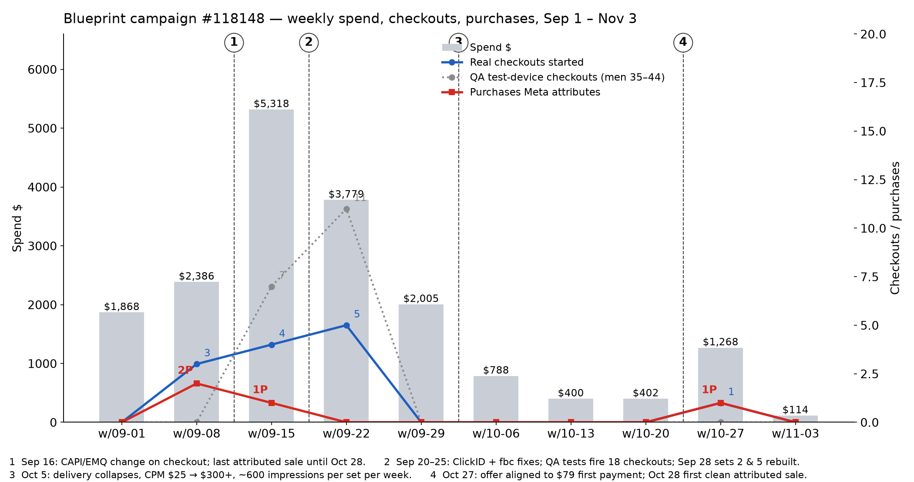
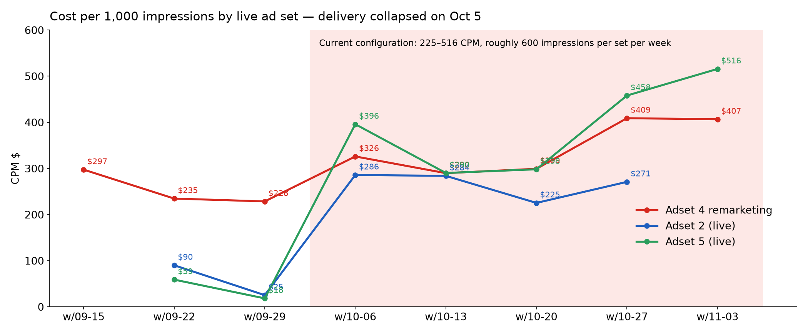
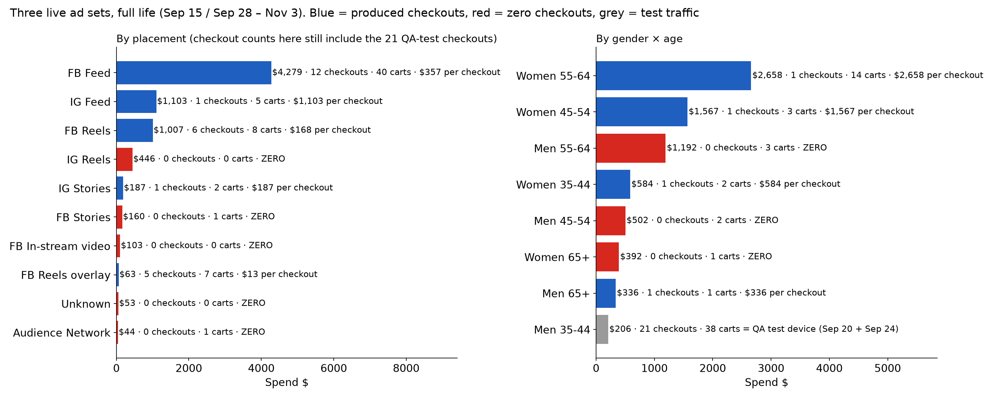

# Blueprint on Meta — mission file

Longevity Life Academy · ad account 1459085242361281 · all numbers pulled live Nov 3 2026, 13:10–14:00 Israel · Meta paid media only.

**Mission: Blueprint sales from Meta, starting today, by putting the Blueprint behind the exact formula that is already producing 20–60 Masterclass purchases a week in this account.**

---

## 0. The decision, on one screen

| # | Action | Where | Setting | Budget |
|---|---|---|---|---:|
| 1 | Pause | Blueprint Adset 2 #108808, Adset 5 #108811, Julie video #12 | they share the Masterclass audience and lose it: 0 checkouts since Oct 6 | −$84 |
| 2 | New ad | Ad#17 video (the 135-purchase asset) + Blueprint copy + Blueprint link | section 4 | — |
| 3 | New set **BP-WARM** | Masterclass buyers + Masterclass checkout starters | 35–65+, FB Feed + Reels, mobile, Purchase | $80 |
| 4 | New set **BP-FORMULA** | the #108816 recipe: 41 interests ∧ Engaged Shoppers ∧ income top 25%, **55–65+**, FB Reels + Feed, mobile | the cells that gave 152 of 199 Masterclass purchases | $100 |
| 5 | Edit #108816 | add the Ad#17-Blueprint ad as 2nd ad; budget $48 → $120 | set is already in learning after your Nov 2 edit, so the change is free | +$72 |
| 6 | Rebuild Blueprint Adset 4 | remarketing → Initiate Checkout opt, exclude buyers, drop leads/video lists, FB Feed + Reels, mobile, ads = Ad#17-Blueprint + Courtney | | $40 |

Net: **$292/day** (today $223) with $84 moved out of a dead auction. First read +24 h, decision read Nov 6, full read Nov 10. Expected on Masterclass benchmarks: first Blueprint sale inside 48 h from BP-WARM, 2–4 Blueprint sales in week 1 across the four surfaces at $350–550 each, against $4,580 today.

---

## 1. What the Masterclass campaign proved (Sep 28 – Nov 3, $73,826, 199 purchases, $371 each)

### 1.1 The formula is the same in every set. Only age, gender and placement differ.

Every Masterclass set targets **41 interests AND Engaged Shoppers AND household income top 10% (or top 25%) of US ZIPs**, Advantage audience off, lowest cost, Purchase optimization. Ad#17 ("Woman · Five habits", UGC, vertical + square) is the ad in all of them.

| Set | Age | Gender | Placements | Income | Spend | CPM | CPC | Clicks → purchase | Purchases | Cost / purchase |
|---|---|---|---|---|---:|---:|---:|---:|---:|---:|
| **#108816** (active, $48) | 35–65+ | all | FB Feed + FB Reels + IG Feed, mobile + desktop | top 25% | $24,311 | $478 | $9.67 | 3.1% | **77** | **$316** |
| **#108817** (active, $21) | 45–65+ | all | FB Reels only, mobile | top 10% | $16,730 | $530 | $9.58 | 2.6% | **45** | **$372** |
| #108813 (paused Oct 29) | 44–65+ | all | FB Feed + Reels, mobile + desktop | top 25% | $13,480 | $536 | $14.76 | 3.6% | 33 | $408 |
| #108815 (paused Oct 27) | 45–64 | women | FB Feed + Reels, mobile · **lookalikes** (checkout starters 1%/2%, purchasers) | — | $11,219 | $326 | $9.27 | 1.9% | 23 | $488 |
| #108818 (paused Oct 20) | 55–65+ | women | FB Reels only, mobile | top 10% | $4,115 | $455 | $9.75 | 1.9% | 8 | $514 |
| **#108814** (active, $33) | 44–65+ | all | FB Feed + Reels · **warm: Masterclass IC30 + purchaser lists**, buyers excluded | — | $3,971 | $574 | $13.33 | **4.4%** | 13 | **$305** |

Reads: the interest ∧ shoppers ∧ income stack with no gender filter and the 65+ door open (#108816) is the best cold set in the account. Warm Masterclass checkout starters (#108814) convert clicks best of all, 4.4%. Lookalikes alone (#108815) and women-only (#108815, #108818) are the two weakest variants: narrowing to women cost $100–200 per purchase.

### 1.2 Age × gender, all six sets

| Cell | Spend | CPM | Clicks | Checkouts | Purchases | Cost / purchase | Clicks → purchase |
|---|---:|---:|---:|---:|---:|---:|---:|
| **Women 65+** | $23,430 | $540 | 2,342 | 91 | **63** | **$372** | 2.7% |
| **Women 55–64** | $19,297 | $491 | 1,930 | 77 | **57** | **$339** | 3.0% |
| **Men 65+** | $11,510 | $502 | 970 | 42 | **32** | **$360** | 3.3% |
| Women 45–54 | $8,550 | $400 | 889 | 33 | 22 | $389 | 2.5% |
| Men 55–64 | $6,625 | $428 | 531 | 25 | 16 | $414 | 3.0% |
| Men 45–54 | $2,049 | $405 | 170 | 9 | 4 | $512 | 2.4% |
| Women 35–44 | $1,629 | $195 | 196 | 2 | 1 | $1,629 | 0.5% |
| Men 35–44 | $287 | $233 | 32 | 2 | 2 | $144 | 6.2% (2 sales, noise) |

**152 of 199 purchases (76%) are 55+. 95 of 199 (48%) are 65+.** Under 45 is dead at any price: $1,916 → 3 purchases.

Inside #108816 alone: women 65+ $296 per purchase (34), women 55–64 $298 (25), women 45–54 $319 (10), men 55–64 $246 (3), men 65+ $453 (3).

### 1.3 Placement, all six sets

| Placement | Spend | CPM | Clicks | Purchases | Cost / purchase | Clicks → purchase |
|---|---:|---:|---:|---:|---:|---:|
| **FB Reels** | $60,464 | $625 | 6,107 | **170** | **$356** | 2.8% |
| FB Feed | $10,835 | $392 | 662 | 27 | $401 | **4.1%** |
| IG Feed | $1,990 | $521 | 88 | 2 | $995 | 2.3% |
| FB Reels overlay | $272 | $9 | 226 | 0 | — | 0% |

FB Reels carries the account: 85% of purchases. FB Feed is cheaper per 1,000 and converts clicks better but gets little delivery with a vertical UGC asset. Instagram is a loss at every age. Stories were never used.

### 1.4 Device, all six sets

| Device | Spend | CPM | Purchases | Cost / purchase |
|---|---:|---:|---:|---:|
| **iPhone (app)** | $61,825 | $563 | **176** | **$351** |
| Android phone | $7,562 | $203 | 18 | $420 |
| iPad | $2,418 | $458 | 4 | $604 |
| Desktop | $1,394 | $430 | 0 | — |

88% of purchases are iPhone. Desktop: $1,394, zero.

### 1.5 Region

Spend spreads across 40+ states at $360–540 CPM with no state cheaper or dearer by more than ±25%. Meta does not return conversions at state level for these sets. No state lever; do not geo-narrow.

### 1.6 What the Masterclass campaign says about CPM

The whole account moved from $26–80 CPM to $400–520 on Oct 4–5, the days the Masterclass scaled to $3k/day on Purchase optimization, and has lived at $250–820 since. Masterclass sets convert anyway because Ad#17 turns 2.6–4.4% of clicks into sales. That is the environment every Blueprint set has to live in: **CPM will be $400–700. The only variables that matter are click-to-purchase rate and whether the set gets delivery at all.**

---

## 2. Why Blueprint failed against that formula

| | Masterclass winners | Blueprint Adsets 2 + 5 (live) | Blueprint Adset 4 (live) |
|---|---|---|---|
| Interests ∧ shoppers ∧ income | yes | yes, identical 41 interests + shoppers + top 25% | remarketing lists |
| Age ceiling | **65+ open** (48% of sales) | **capped at 64** | 65+ open |
| Gender | all | all | all |
| Placements | FB Reels + FB Feed | FB Reels, FB Feed, **IG Feed, IG Reels** | same, plus IG Stories |
| Devices | mobile (iPhone 88% of sales) | mobile **+ desktop** | mobile + desktop |
| Ad | Ad#17 UGC, 2.6–4.4% click → sale | Julie video #12: 3,946 clicks, 0 real checkouts; Julie static | Courtney (both remarketing sales), Julie |
| Purchase signal reaching the set | 20–60 purchases/week | 0 since Sep 13 | 2 in 7 weeks |
| Result since Oct 6 | 16–27 purchases/week in #108816 | 91 clicks, 0 checkouts, $1,654 | 88 clicks, 1 checkout, 1 sale, $1,323 |

Blueprint's cold sets were the Masterclass formula with the best age cell removed, two dead platforms added, desktop added, a non-converting ad, and no purchase events for Meta to learn from, bidding against the Masterclass sets for the same people. Auction logic: when two of your own sets want the same person, Meta enters only the higher-ranked one; the Masterclass set, with a live purchase rate, wins every time. Blueprint got the leftovers at $266–388 CPM. Full Blueprint evidence in Appendix B.

---

## 3. The war plan: exact settings

All new sets go inside the Masterclass campaign shell **52668266203628** (healthy delivery, no campaign-level drag). Nothing else in that campaign is touched except #108816.

### 3.1 Pause (Blueprint campaign 52663511211628)
- Adset 2 #108808 → 52669013718628 · Adset 5 #108811 → 52669048300628 · Julie video #12 in every set.

### 3.2 The ad: `BP | Ad17 Five habits | Blueprint`
- Videos: square `1748787486227637`, vertical `2236898053915469` (from Ad#17 creative 1444916017846546), same placement customization (vertical → Reels/Stories, square → Feed).
- Page 1179505785236150 · IG 17841432251901978.
- Link: `https://longevitylifeacademy.pages.dev/?offer=MASTERCLASS-VIP&utm_source=fb&utm_medium=paid&utm_campaign=bp-ad17&utm_content={{ad.name}}`
- CTA: Sign Up. Copy: section 4.
- Second ad in every Blueprint set: Courtney video #3 (creative on ad 52669042694228). Two ads per set, no more.

### 3.3 `BP-WARM | Masterclass buyers + checkout starters | 35-65+ | FB Feed+Reels | mobile` — $80/day
- Include: `Julie Masterclass | CRM paid buyers 101` 52673824207628 · `Julie Masterclass | CRM paid purchasers` (the purchaser list used in #108815/#108814) · `Julie campaign IC30` 52673824370228.
- Exclude: nothing.
- US · all genders · 35–65+ · FB Feed + FB Reels · mobile · Advantage audience off.
- Purchase optimization · lowest cost · 7-day click, 1-day view.
- Benchmark: #108814 on the non-buyer half of this pool does 4.4% click → purchase at $305.
- Why it delivers today: the lists are small and warm; Meta serves them within the hour.

### 3.4 `BP-FORMULA | 41 int ∧ shoppers ∧ income 25% | 55-65+ | FB Reels+Feed | mobile` — $100/day
- Duplicate #108816 (52668330870828) inside the same campaign; keep the interest stack, Engaged Shoppers and both income brackets exactly as they are.
- Change only: age **55–65+** · remove Instagram · remove desktop · exclude `Purchase - 30 Days` and buyers 101 (they belong to BP-WARM).
- Ads: Ad#17-Blueprint + Courtney video #3.
- Audience size: #108816 at 35–65+ is 88–104M; 55–65+ is roughly 35–45M. Big enough that overlap with #108816 costs delivery, not CPM.
- Benchmark: women 65+, women 55–64, men 65+ inside this stack are $339–372 per Masterclass purchase. Blueprint's first payment is $79, same ticket as the VIP masterclass; the honest expectation is a lower click → sale rate, so plan on $450–650 per Blueprint sale here, not $350.

### 3.5 #108816 (52668330870828): add the Blueprint ad, raise the budget
- Add `BP | Ad17 Five habits | Blueprint` as a second active ad. Do not touch the Masterclass ad.
- Budget $48 → $120. The set re-entered learning on your Nov 2 edit (learning_stage_info: last significant edit Nov 2), so a budget move costs nothing now.
- Meta will route 60–80% of spend to the ad that converts cheaper, which will be the Masterclass ad. Both outcomes feed Blueprint: a Masterclass buyer lands in BP-WARM within 24 h.
- Nov 6 rule: if the Blueprint ad has under 10% of the set's spend, move it to its own clone of #108816 at $100 and reset #108816 to $48.

### 3.6 Blueprint Adset 4 remarketing (52666232368428) — $40/day
- Optimization → **Initiate Checkout** until the campaign logs 10+ purchases, then back to Purchase.
- Keep site 30/90, checkout 30/90, cart 30/90. Remove leads 30/90, form openers, both video-viewer lists.
- Exclude buyers 101.
- FB Feed + FB Reels · mobile · 45–65+ · all genders.
- Ads: Ad#17-Blueprint + Courtney video #3. Pause the rest.

### 3.7 Guardrails
- No set gets more than two ads. No new sets beyond these. No edits between reads.
- Any set with CPM above $900 after 48 h and under 50 clicks: pause it, do not tune it.
- Any set at 10+ clicks and 0 carts after $300: pause the Julie/Courtney ad with the worse CTR, keep the other.

### 3.8 Read-out schedule

| When | Look at | Decide |
|---|---|---|
| +2 h | BP-WARM impressions > 0 | if 0: switch BP-WARM to Initiate Checkout optimization |
| +24 h | all four: impressions, CPM, clicks, carts, checkouts, sales | nothing unless a guardrail trips |
| Nov 6 | #108816 spend share of the Blueprint ad; BP-FORMULA cost per checkout | <10% share → clone rule in 3.5; BP-FORMULA cost per checkout > $250 → cut to 65+ women + men only |
| Nov 10 | full table, same columns as section 1 | scale the set with the lowest cost per sale by +50%, pause the worst |

---

## 4. Ad copy, paste as is

**Primary text**

Five habits got Julie Gibson Clark ranked the world's second-slowest ager in the 2023 Rejuvenation Olympics, ahead of Bryan Johnson. The Blueprint is where she hands you the whole protocol, not the highlights.

Longevity Life Academy Blueprint:
• 18 live weekly sessions with Julie and the faculty, cohorts of 8–15
• Your personal longevity protocol, written for you: nutrition, movement, sleep, daily habits
• Monday or Wednesday cohorts, starting November
• VIP seat at Julie's live masterclass on November 14, 1 pm Eastern, with the private 30-minute Q&A, included

The masterclass is the taste. The Blueprint is the program.

$79 today, then 4 monthly payments of $169. Cohorts are capped at 15.

**Headline:** The Blueprint · 18 weeks with Julie Gibson Clark
**Description:** VIP masterclass seat included · $79 today
**CTA:** Sign Up

---

## Appendix A. Charts

## Appendix B. Blueprint campaign #118148 evidence

What is factored in: bug window Sep 16 → Sep 29 (attribution broken, browser events alive); QA test device (men 35–44, Sep 20–26, 37 carts and 21 checkouts on $53) removed from every "real" figure; every paused set listed with run dates; periods cut on the settings-change dates (Sep 16 pauses, Sep 28 rebuild, Oct 30 budgets, Nov 2 Adset 4 edit); hour of day in account time zone translated to US Eastern; pixel event log by host for real purchases regardless of attribution.

Blueprint headline numbers: $18,337 spent since Sep 3 · 6 real purchases visible (Meta credits 4: Sep 10, Sep 13, Sep 16, Oct 28; pixel adds Oct 7 and Oct 31) · 49 real carts, 10 real checkouts · cold prospecting $14,182 → 2 sales, both before Sep 14 · current configuration since Oct 6: $2,977 → 5 carts, 1 checkout, 1 sale.

