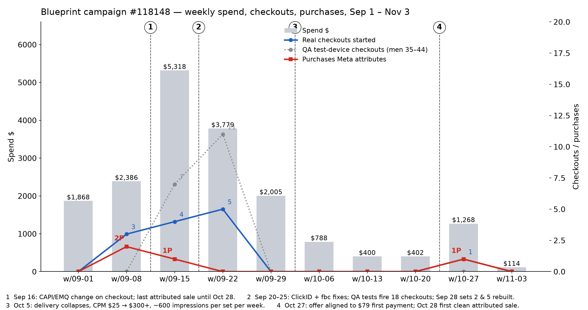
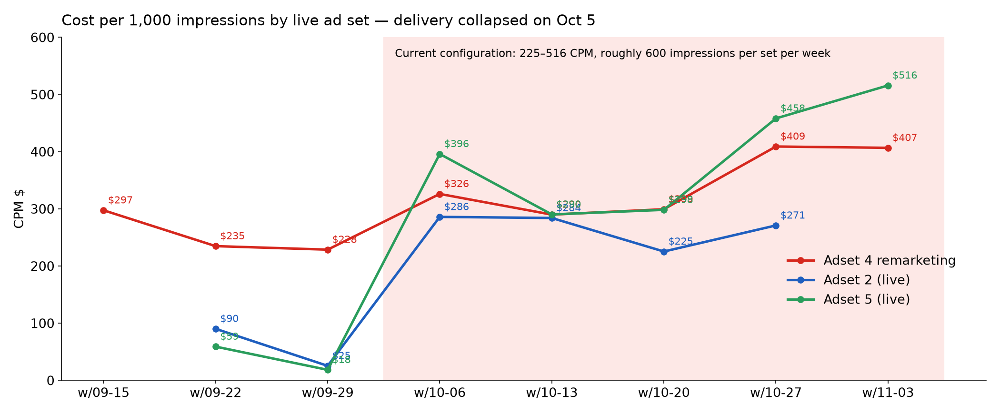
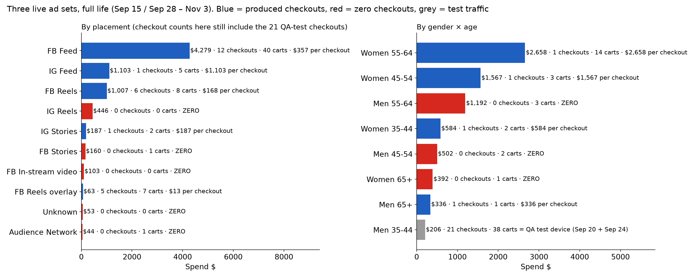

# Blueprint on Meta — mission file

**→ [STAGE-1.md](STAGE-1.md): every Blueprint ad set's exact configuration, every audience (seeds, lookalike %, sizes, failures, where used), last 14 days day-by-day with change markers, all-time spend per placement / gender × age / device per ad set.**

Longevity Life Academy · ad account 1459085242361281 · all numbers pulled live Nov 3 2026, 13:10–14:00 Israel · Meta paid media only.

**Mission: Blueprint sales from Meta, starting today, by putting the Blueprint behind the exact formula that is already producing 20–60 Masterclass purchases a week in this account.**

---

## 0. The decision, on one screen

Masterclass sets are terminated. Everything below runs inside the Blueprint campaign 52663511211628 and stands on its own. With the Masterclass sets off, the Blueprint sets stop bidding against your own account for the same people.

| # | Action | Exact setting | Budget |
|---|---|---|---:|
| 1 | **Pause** Adset 2 #108808 (52669013718628), Adset 5 #108811 (52669048300628), Julie video #12 everywhere | 0 checkouts since Oct 6 on $1,654 | −$84 |
| 2 | **Build the ad** `BP | Ad17 Five habits | Blueprint` | Ad#17 videos (square 1748787486227637, vertical 2236898053915469) + Blueprint copy (section 4) + link `https://longevitylifeacademy.pages.dev/?offer=MASTERCLASS-VIP&utm_source=fb&utm_campaign=bp-ad17` · CTA Sign Up | — |
| 3 | **New set BP-WARM** | Include Masterclass buyers 101 (52673824207628) + CRM paid purchasers + Masterclass IC30 (52673824370228). No exclusions. US · all genders · 35–65+ · FB Feed + FB Reels · mobile · Advantage audience off · Purchase, 7d click 1d view. Ads: Ad#17-Blueprint + Courtney video #3 | $80 |
| 4 | **New set BP-FORMULA** | The proven stack: 41 interests ∧ Engaged Shoppers ∧ household income top 10% + 10–25% (copy from Adset 2's flexible_spec). US · all genders · **55–65+** · FB Feed + FB Reels · mobile · Advantage audience off · exclude buyers 101 and Purchase-30d · Purchase, 7d click 1d view. Ads: Ad#17-Blueprint + Courtney video #3 | $120 |
| 5 | **Rebuild Adset 4** remarketing (52666232368428) | Optimization → Initiate Checkout until 10 purchases logged. Keep site 30/90, checkout 30/90, cart 30/90; remove leads 30/90, form openers, both video-viewer lists. Exclude buyers 101. FB Feed + FB Reels · mobile · 45–65+. Ads: Ad#17-Blueprint + Courtney video #3; pause the rest | $40 |

Net **$240/day** (today $223). Two ads per set, no more. No edits between reads.

**Why these three sets:** in the Masterclass data (section 1) the identical interest ∧ shoppers ∧ income stack produced 199 purchases; 76% were 55+, 48% were 65+, 85% came from FB Reels, 88% from iPhone, Instagram and desktop produced 2 and 0. Warm Masterclass checkout starters converted 4.4% of clicks, the best in the account. Blueprint's cold sets ran that stack capped at 64 with Instagram and desktop added and a non-converting ad (section 2).

**Reads:** +2 h BP-WARM delivering (if 0 impressions → switch it to Initiate Checkout). +24 h all three: CPM, clicks, carts, checkouts, sales. Nov 6: BP-FORMULA cost per checkout > $250 → cut to 65+ only. Nov 10: scale the lowest cost per sale +50%, pause the worst. Guardrails: CPM > $900 after 48 h with < 50 clicks → pause; $300 spent, 10+ clicks, 0 carts → pause the weaker-CTR ad.

**Expected week 1 on Masterclass benchmarks, discounted for the higher Blueprint ticket:** BP-WARM first sale inside 48 h at $300–500; BP-FORMULA $450–650 per sale; 2–4 Blueprint sales in week 1 against $4,580 per sale today.

---

## 1. What the Masterclass campaign proved (Sep 28 – Nov 3, $73,826, 199 purchases, $371 each)

### 1.1 The formula is the same in every set. Only age, gender and placement differ.

Every Masterclass set targets **41 interests AND Engaged Shoppers AND household income top 10% (or top 25%) of US ZIPs**, Advantage audience off, lowest cost, Purchase optimization. Ad#17 ("Woman · Five habits", UGC, vertical + square) is the ad in all of them.

| Set | Age | Gender | Placements | Income | Spend | CPM | CPC | Clicks → purchase | Purchases | Cost / purchase |
|---|---|---|---|---|---:|---:|---:|---:|---:|---:|
| **#108816** (active, $48) | 35–65+ | all | FB Feed + FB Reels + IG Feed, mobile + desktop | top 25% | $24,311 | $478 | $9.67 | 3.1% | **77** | **$316** |
| **#108817** (active, $21) | 45–65+ | all | FB Reels only, mobile | top 10% | $16,730 | $530 | $9.58 | 2.6% | **45** | **$372** |
| #108813 (paused Oct 29) | 44–65+ | all | FB Feed + Reels, mobile + desktop | top 25% | $13,480 | $536 | $14.76 | 3.6% | 33 | $408 |
| #108815 (paused Oct 27) | 45–64 | women | FB Feed + Reels, mobile · **lookalikes** (checkout starters 1%/2%, purchasers) | — | $11,219 | $326 | $9.27 | 1.9% | 23 | $488 |
| #108818 (paused Oct 20) | 55–65+ | women | FB Reels only, mobile | top 10% | $4,115 | $455 | $9.75 | 1.9% | 8 | $514 |
| **#108814** (active, $33) | 44–65+ | all | FB Feed + Reels · **warm: Masterclass IC30 + purchaser lists**, buyers excluded | — | $3,971 | $574 | $13.33 | **4.4%** | 13 | **$305** |

Reads: the interest ∧ shoppers ∧ income stack with no gender filter and the 65+ door open (#108816) is the best cold set in the account. Warm Masterclass checkout starters (#108814) convert clicks best of all, 4.4%. Lookalikes alone (#108815) and women-only (#108815, #108818) are the two weakest variants: narrowing to women cost $100–200 per purchase.

### 1.2 Age × gender, all six sets

| Cell | Spend | CPM | Clicks | Checkouts | Purchases | Cost / purchase | Clicks → purchase |
|---|---:|---:|---:|---:|---:|---:|---:|
| **Women 65+** | $23,430 | $540 | 2,342 | 91 | **63** | **$372** | 2.7% |
| **Women 55–64** | $19,297 | $491 | 1,930 | 77 | **57** | **$339** | 3.0% |
| **Men 65+** | $11,510 | $502 | 970 | 42 | **32** | **$360** | 3.3% |
| Women 45–54 | $8,550 | $400 | 889 | 33 | 22 | $389 | 2.5% |
| Men 55–64 | $6,625 | $428 | 531 | 25 | 16 | $414 | 3.0% |
| Men 45–54 | $2,049 | $405 | 170 | 9 | 4 | $512 | 2.4% |
| Women 35–44 | $1,629 | $195 | 196 | 2 | 1 | $1,629 | 0.5% |
| Men 35–44 | $287 | $233 | 32 | 2 | 2 | $144 | 6.2% (2 sales, noise) |

**152 of 199 purchases (76%) are 55+. 95 of 199 (48%) are 65+.** Under 45 is dead at any price: $1,916 → 3 purchases.

Inside #108816 alone: women 65+ $296 per purchase (34), women 55–64 $298 (25), women 45–54 $319 (10), men 55–64 $246 (3), men 65+ $453 (3).

### 1.3 Placement, all six sets

| Placement | Spend | CPM | Clicks | Purchases | Cost / purchase | Clicks → purchase |
|---|---:|---:|---:|---:|---:|---:|
| **FB Reels** | $60,464 | $625 | 6,107 | **170** | **$356** | 2.8% |
| FB Feed | $10,835 | $392 | 662 | 27 | $401 | **4.1%** |
| IG Feed | $1,990 | $521 | 88 | 2 | $995 | 2.3% |
| FB Reels overlay | $272 | $9 | 226 | 0 | — | 0% |

FB Reels carries the account: 85% of purchases. FB Feed is cheaper per 1,000 and converts clicks better but gets little delivery with a vertical UGC asset. Instagram is a loss at every age. Stories were never used.

### 1.4 Device, all six sets

| Device | Spend | CPM | Purchases | Cost / purchase |
|---|---:|---:|---:|---:|
| **iPhone (app)** | $61,825 | $563 | **176** | **$351** |
| Android phone | $7,562 | $203 | 18 | $420 |
| iPad | $2,418 | $458 | 4 | $604 |
| Desktop | $1,394 | $430 | 0 | — |

88% of purchases are iPhone. Desktop: $1,394, zero.

### 1.5 Region

Spend spreads across 40+ states at $360–540 CPM with no state cheaper or dearer by more than ±25%. Meta does not return conversions at state level for these sets. No state lever; do not geo-narrow.

### 1.6 What the Masterclass campaign says about CPM

The whole account moved from $26–80 CPM to $400–520 on Oct 4–5, the days the Masterclass scaled to $3k/day on Purchase optimization, and has lived at $250–820 since. Masterclass sets convert anyway because Ad#17 turns 2.6–4.4% of clicks into sales. That is the environment every Blueprint set has to live in: **CPM will be $400–700. The only variables that matter are click-to-purchase rate and whether the set gets delivery at all.**

---

## 2. Why Blueprint failed against that formula

| | Masterclass winners | Blueprint Adsets 2 + 5 (live) | Blueprint Adset 4 (live) |
|---|---|---|---|
| Interests ∧ shoppers ∧ income | yes | yes, identical 41 interests + shoppers + top 25% | remarketing lists |
| Age ceiling | **65+ open** (48% of sales) | **capped at 64** | 65+ open |
| Gender | all | all | all |
| Placements | FB Reels + FB Feed | FB Reels, FB Feed, **IG Feed, IG Reels** | same, plus IG Stories |
| Devices | mobile (iPhone 88% of sales) | mobile **+ desktop** | mobile + desktop |
| Ad | Ad#17 UGC, 2.6–4.4% click → sale | Julie video #12: 3,946 clicks, 0 real checkouts; Julie static | Courtney (both remarketing sales), Julie |
| Purchase signal reaching the set | 20–60 purchases/week | 0 since Sep 13 | 2 in 7 weeks |
| Result since Oct 6 | 16–27 purchases/week in #108816 | 91 clicks, 0 checkouts, $1,654 | 88 clicks, 1 checkout, 1 sale, $1,323 |

Blueprint's cold sets were the Masterclass formula with the best age cell removed, two dead platforms added, desktop added, a non-converting ad, and no purchase events for Meta to learn from, bidding against the Masterclass sets for the same people. Auction logic: when two of your own sets want the same person, Meta enters only the higher-ranked one; the Masterclass set, with a live purchase rate, wins every time. Blueprint got the leftovers at $266–388 CPM. Full Blueprint evidence in Appendix B.

---

## 3. The war plan: exact settings

All sets live inside the Blueprint campaign **52663511211628**. Masterclass sets are terminated; nothing depends on them.

### 3.1 Pause (Blueprint campaign 52663511211628)
- Adset 2 #108808 → 52669013718628 · Adset 5 #108811 → 52669048300628 · Julie video #12 in every set.

### 3.2 The ad: `BP | Ad17 Five habits | Blueprint`
- Videos: square `1748787486227637`, vertical `2236898053915469` (from Ad#17 creative 1444916017846546), same placement customization (vertical → Reels/Stories, square → Feed).
- Page 1179505785236150 · IG 17841432251901978.
- Link: `https://longevitylifeacademy.pages.dev/?offer=MASTERCLASS-VIP&utm_source=fb&utm_medium=paid&utm_campaign=bp-ad17&utm_content={{ad.name}}`
- CTA: Sign Up. Copy: section 4.
- Second ad in every Blueprint set: Courtney video #3 (creative on ad 52669042694228). Two ads per set, no more.

### 3.3 `BP-WARM | Masterclass buyers + checkout starters | 35-65+ | FB Feed+Reels | mobile` — $80/day
- Include: `Julie Masterclass | CRM paid buyers 101` 52673824207628 · `Julie Masterclass | CRM paid purchasers` (the purchaser list used in #108815/#108814) · `Julie campaign IC30` 52673824370228.
- Exclude: nothing.
- US · all genders · 35–65+ · FB Feed + FB Reels · mobile · Advantage audience off.
- Purchase optimization · lowest cost · 7-day click, 1-day view.
- Benchmark: #108814 on the non-buyer half of this pool does 4.4% click → purchase at $305.
- Why it delivers today: the lists are small and warm; Meta serves them within the hour.

### 3.4 `BP-FORMULA | 41 int ∧ shoppers ∧ income 25% | 55-65+ | FB Reels+Feed | mobile` — $120/day
- Create in the Blueprint campaign with the Masterclass stack: the 41 interests, Engaged Shoppers, household income top 10% and 10–25% (identical to Adset 2's flexible_spec, so copy it from 52669013718628).
- Age **55–65+** · US · all genders · FB Feed + FB Reels · mobile · Advantage audience off · exclude `Purchase - 30 Days` and buyers 101 (they belong to BP-WARM).
- Ads: Ad#17-Blueprint + Courtney video #3.
- Audience size: #108816 at 35–65+ is 88–104M; 55–65+ is roughly 35–45M. Big enough that overlap with #108816 costs delivery, not CPM.
- Benchmark: women 65+, women 55–64, men 65+ inside this stack are $339–372 per Masterclass purchase. Blueprint's first payment is $79, same ticket as the VIP masterclass; the honest expectation is a lower click → sale rate, so plan on $450–650 per Blueprint sale here, not $350.

### 3.5 Masterclass sets
Terminated. Their audiences and learnings are reused in 3.3 and 3.4; no set depends on them being live.

### 3.6 Blueprint Adset 4 remarketing (52666232368428) — $40/day
- Optimization → **Initiate Checkout** until the campaign logs 10+ purchases, then back to Purchase.
- Keep site 30/90, checkout 30/90, cart 30/90. Remove leads 30/90, form openers, both video-viewer lists.
- Exclude buyers 101.
- FB Feed + FB Reels · mobile · 45–65+ · all genders.
- Ads: Ad#17-Blueprint + Courtney video #3. Pause the rest.

### 3.7 Guardrails
- No set gets more than two ads. No new sets beyond these. No edits between reads.
- Any set with CPM above $900 after 48 h and under 50 clicks: pause it, do not tune it.
- Any set at 10+ clicks and 0 carts after $300: pause the Julie/Courtney ad with the worse CTR, keep the other.

### 3.8 Read-out schedule

| When | Look at | Decide |
|---|---|---|
| +2 h | BP-WARM impressions > 0 | if 0: switch BP-WARM to Initiate Checkout optimization |
| +24 h | all four: impressions, CPM, clicks, carts, checkouts, sales | nothing unless a guardrail trips |
| Nov 6 | BP-FORMULA cost per checkout; BP-WARM sales | BP-FORMULA cost per checkout > $250 → cut to 65+ only |
| Nov 10 | full table, same columns as section 1 | scale the set with the lowest cost per sale by +50%, pause the worst |

---

## 4. Ad copy, paste as is

**Primary text**

Five habits got Julie Gibson Clark ranked the world's second-slowest ager in the 2023 Rejuvenation Olympics, ahead of Bryan Johnson. The Blueprint is where she hands you the whole protocol, not the highlights.

Longevity Life Academy Blueprint:
• 18 live weekly sessions with Julie and the faculty, cohorts of 8–15
• Your personal longevity protocol, written for you: nutrition, movement, sleep, daily habits
• Monday or Wednesday cohorts, starting November
• VIP seat at Julie's live masterclass on November 14, 1 pm Eastern, with the private 30-minute Q&A, included

The masterclass is the taste. The Blueprint is the program.

$79 today, then 4 monthly payments of $169. Cohorts are capped at 15.

**Headline:** The Blueprint · 18 weeks with Julie Gibson Clark
**Description:** VIP masterclass seat included · $79 today
**CTA:** Sign Up

---

## Appendix A. Charts

## Appendix B. Blueprint campaign #118148 evidence

What is factored in: bug window Sep 16 → Sep 29 (attribution broken, browser events alive); QA test device (men 35–44, Sep 20–26, 37 carts and 21 checkouts on $53) removed from every "real" figure; every paused set listed with run dates; periods cut on the settings-change dates (Sep 16 pauses, Sep 28 rebuild, Oct 30 budgets, Nov 2 Adset 4 edit); hour of day in account time zone translated to US Eastern; pixel event log by host for real purchases regardless of attribution.

Blueprint headline numbers: $18,337 spent since Sep 3 · 6 real purchases visible (Meta credits 4: Sep 10, Sep 13, Sep 16, Oct 28; pixel adds Oct 7 and Oct 31) · 49 real carts, 10 real checkouts · cold prospecting $14,182 → 2 sales, both before Sep 14 · current configuration since Oct 6: $2,977 → 5 carts, 1 checkout, 1 sale.

### B1. Four periods, every set, tests removed

**P0 · Sep 3–15 · clean, before the bug**

| Set | Days | Spend | Impr. | CPM | Clicks | CPC | Carts | Checkouts | Purchases |
|---|---:|---:|---:|---:|---:|---:|---:|---:|---:|
| Adset 2 v1 #108808 (interests 11, 35–64) | 13 | $2,902 | 103,609 | $28 | 1,948 | $1.49 | 5 | 3 | **2** (Sep 10, Sep 13) |
| Adset 1 #108807 (interests 11, 18–65) | 6 | $1,244 | 44,584 | $28 | 353 | $3.52 | 1 | 0 | 0 |
| Adset 3 #108809 (broad 18–65) | 7 | $568 | 26,485 | $21 | 415 | $1.37 | 0 | 0 | 0 |
| Adset 4 #108810 remarketing (day 1) | 1 | $51 | 130 | $394 | 3 | — | 1 | 1 | 0 |

**P1 · Sep 16–29 · bug window (attribution broken, browser events alive)**

| Set | Days | Spend | Impr. | CPM | Clicks | CPC | Carts | Checkouts | Purchases |
|---|---:|---:|---:|---:|---:|---:|---:|---:|---:|
| Adset 2 v1 #108808 | 14 | $4,648 | 206,610 | $22 | 2,470 | $1.88 | 11 | 1 | 0 |
| Adset 4 #108810 remarketing | 14 | $2,464 | 9,698 | $254 | 172 | $14.33 | 15 | 2 | **1** (Sep 16, woman 55–64) |
| Adset 5 v1 #108811 (broad 35–64) | 13 | $1,437 | 9,376 | $153 | 131 | $10.97 | 5 | 2 | 0 |
| Adset 2 v2 + Adset 5 v2 (born Sep 28) | 2 | $427 | 11,388 | $37 | 122 | $3.50 | 0 | 0 | 0 |

**P2 · Sep 30–Oct 5 · bug fixed, delivery still normal**

| Set | Days | Spend | Impr. | CPM | Clicks | CPC | Carts | Checkouts | Purchases |
|---|---:|---:|---:|---:|---:|---:|---:|---:|---:|
| Adset 2 v2 #108808 (41 interests ∧ shoppers ∧ income, 45–64) | 6 | $725 | 29,751 | $24 | 424 | $1.71 | 3 | 0 | 0 |
| Adset 5 v2 #108811 (identical) | 6 | $578 | 34,075 | $17 | 491 | $1.18 | 2 | 0 | 0 |
| Adset 4 #108810 remarketing | 6 | $313 | 1,431 | $218 | 25 | $12.50 | 1 | 0 | 0 |

**P3 · Oct 6–Nov 3 · current configuration, delivery collapsed**

| Set | Days | Spend | Impr. | CPM | Clicks | CPC | Carts | Checkouts | Purchases |
|---|---:|---:|---:|---:|---:|---:|---:|---:|---:|
| Adset 4 #108810 remarketing | 29 | $1,323 | 3,706 | **$357** | 88 | $15.04 | 3 | 1 | **1** (Oct 28, woman 35–44) |
| Adset 2 v2 #108808 | 29 | $793 | 2,985 | **$266** | 59 | $13.43 | 1 | 0 | 0 |
| Adset 5 v2 #108811 | 29 | $861 | 2,218 | **$388** | 32 | $26.90 | 1 | 0 | 0 |

What the four periods say:

- The bug window (P1) is not hiding a good campaign. $9,000 bought 31 real carts and 5 real checkouts. P0, with clean attribution, had the same cart rate (0.3% of clicks).
- The six clean post-fix days (P2) are the fairest test of the rebuilt interest sets: $1,303, 915 clicks at $1.18–1.71, 5 carts, 0 checkouts. That is the audience failing, not the pixel.
- P3 is a different failure. Impressions per week fell from 75,000 to 1,400–3,300. Clicks went from $1.18 to $13–27. Nothing in P3 is a read on audiences; it is a read on broken delivery.

### B2. Every set that ever ran, including paused ones

| Set | ID | Ran | Status | Budget | Targeting | Spend | Clicks | Carts | Checkouts | Purchases |
|---|---|---|---|---:|---|---:|---:|---:|---:|---:|
| Adset 1 #108807 | 52663511359228 | Sep 3–8 | Paused Sep 16 | $1 | 11 interests, 18–65, 34 states | $1,244 | 353 | 1 | 0 | 0 |
| Adset 2 v1 #108808 | 52663512093428 | Sep 3–28 | Paused Sep 28 | $160 | 11 interests, 35–64, 34 states | $7,550 | 4,418 | 16 | 4 | 2 |
| Adset 3 #108809 | 52664534627228 | Sep 9–14 | Paused Sep 16 | $100 | broad, 18–65, 34 states | $568 | 415 | 0 | 0 | 0 |
| Adset 5 v1 #108811 | 52666296222628 | Sep 16–28 | Paused Sep 28 | $40 | broad, 35–64, 34 states | $1,437 | 131 | 5 | 2 | 0 |
| Adset 4 #108810 | 52666232368428 | Sep 15 → live | **Active** | $139 | 11 remarketing lists, 25–65+, 34 states | $4,151 | 288 | 57 (20 real) | 25 (4 real) | 2 |
| Adset 2 v2 #108808 | 52669013718628 | Sep 28 → live | **Active** | $39 | 41 interests ∧ Engaged Shoppers ∧ top-25% income, 45–64, US | $1,778 | 556 | 4 | 0 | 0 |
| Adset 5 v2 #108811 | 52669048300628 | Sep 28 → live | **Active** | $45 | identical to Adset 2 v2 | $1,605 | 572 | 3 | 0 | 0 |
| Blueprint LAL #108779 | 52676923495628 | never | Paused, no ads | $99 | LAL 1% Masterclass buyers, 45–65 | $0 | — | — | — | — |

Cold prospecting total (sets 1, 2 v1, 3, 5 v1, 2 v2, 5 v2): **$14,182, 6,445 clicks, 29 carts, 6 checkouts, 2 purchases**, both before Sep 14.

### B3. How the three live sets are configured right now

| | Adset 4 #108810 | Adset 2 #108808 | Adset 5 #108811 |
|---|---|---|---|
| Budget | $139/day | $39/day | $45/day |
| Optimization | Purchase · lowest cost · 7d click 1d view | same | same |
| Audience | site 30/90d, checkout 30/90d, cart 30/90d, leads 30/90d, form openers, 2 video-viewer lists · **27–32k people** | 41 interests AND Engaged Shoppers AND top-25% income · **40–47M people** | identical copy |
| Exclusions | none (buyers and the QA device inside) | none | none |
| Lookalikes | none | none | none |
| Geo / age / gender | 34 US states · 25–65+ · all | US · 45–64 · all | US · 45–64 · all |
| Advantage audience | off | off | off |
| Placements | FB Feed, FB Reels, IG Feed, IG Reels | same | same |
| Devices | mobile + desktop | same | same |
| Ads spending | Courtney video #3, Courtney static #3, Courtney static #2, Julie video #12, Julie static #6 | Julie video #12, Julie static #6, Courtney static #3 | Julie video #12 |

Audience size is not the reason for the Oct 5 collapse: Adset 2 and 5 reach 40–47 million people. The pattern (Purchase optimization, no Blueprint purchase signal reaching the pixel for weeks, Advantage audience off, three sets competing for the same people) is the one where Meta restricts delivery to a few "predicted buyers" and pays anything for them.

### B4. Placements, three live sets, full life

Checkout counts include the 21 QA-test checkouts, which Meta cannot split by placement. Carts are the cleaner column.

| Placement | Spend | Carts | Checkouts | Read |
|---|---:|---:|---:|---|
| FB Feed | $4,279 | 40 | 12 | the only placement with volume |
| FB Reels | $1,007 | 8 | 6 | second |
| IG Feed | $1,103 | 5 | 1 | $1,103 per checkout |
| IG Reels | $446 | 0 | 0 | zero |
| IG Stories | $187 | 2 | 1 | thin |
| FB Stories | $160 | 1 | 0 | zero |
| In-stream, Reels overlay, Audience Network, unknown | $263 | 8 | 5 | test-device noise |
| Desktop (all placements) | $304 | — | 0 | zero |

Instagram + Stories + desktop + misc: **$2,463, 2 real checkouts.**

### B5. Ages and genders, three live sets, full life

| Cell | Spend | Carts | Checkouts | Read |
|---|---:|---:|---:|---|
| Women 55–64 | $2,658 | 14 | 1 | the only cold cell that carts in volume; credited buyer Sep 16 |
| Women 45–54 | $1,567 | 3 | 1 | credited buyer Sep 10 (Adset 2 v1) |
| Men 55–64 | $1,192 | 3 | 0 | zero |
| Women 35–44 | $584 | 2 | 1 | credited buyer Oct 28 (remarketing) |
| Men 45–54 | $502 | 2 | 0 | credited buyer Sep 13 in v1, nothing since |
| Women 65+ | $392 | 1 | 0 | capped out of Adset 2/5 by the 64 ceiling |
| Men 65+ | $336 | 1 | 1 | thin |
| Men 35–44 | $206 | 38 | 21 | **QA test device** |

Men 45–64 in the live sets: **$1,694, 5 carts, 0 checkouts.**

### B6. Time of day and day of week

Hourly data is in account time zone (Israel). US Eastern = Israel minus 7 hours. Lifetime hours 09:00–14:00 Israel are contaminated by the QA tests (Omri's working hours), so the clean read is the post-fix window Sep 30–Nov 3.

**Sep 30–Nov 3, by Israel hour (US Eastern in brackets)**

| Israel hour | US ET | Spend | Clicks | Carts | Checkouts | Purchases |
|---|---|---:|---:|---:|---:|---:|
| 00–06 | 17:00–23:00 ET | $2,153 | 497 | 8 | 0 | 0 |
| 06–12 | 23:00–05:00 ET | $642 | 165 | 1 | 0 | 0 |
| 12–18 | 05:00–11:00 ET | $1,148 | 248 | 2 | 1 | 1 |
| 18–24 | 11:00–17:00 ET | $648 | 209 | 0 | 0 | 0 |

Half the spend and 8 of 11 carts happen in the US evening (17:00–23:00 ET). The 23:00–05:00 ET block ($642, 1 cart) is the only day-part worth cutting, and it is 14% of spend. Day-parting is not the lever; volume is too small to schedule around.

**Day of week, whole campaign, tests removed**

| Day | Spend | Carts | Checkouts | Purchases | $ per cart |
|---|---:|---:|---:|---:|---:|
| Mon | $2,865 | 8 | 2 | 0 | $358 |
| Tue | $2,395 | 4 | 1 | 0 | $599 |
| Wed | $2,594 | 8 | 3 | 2 | $324 |
| Thu | $3,211 | 7 | 1 | 1 | $459 |
| Fri | $2,300 | 12 | 1 | 0 | $192 |
| Sat | $1,768 | 3 | 1 | 0 | $589 |
| Sun | $3,200 | 7 | 1 | 1 | $457 |

Friday carts cheapest, Saturday and Tuesday worst, but 3–12 carts a day of week is not a schedule, it is noise. No day-of-week action.

### B7. Ads

| Ad | Spend | Clicks | CPC | Real checkouts | Purchases |
|---|---:|---:|---:|---:|---:|
| Julie video #12 (65s) | $4,667 | 3,946 | $1.18 | 0 since Oct 6 | 1 (Sep 13) |
| Julie static #6 | $1,683 | 150 | $11.22 | 2 | 1 (Sep 10) |
| Courtney static #3 | $688 | 53 | $13 | 1 | 1 (Sep 16) |
| Courtney video #3 (75s) | $622 | 33 | $19 | 1 | 1 (Oct 28) |
| Courtney static #2 | $564 | 40 | $14 | 0 | 0 |

Julie video buys the cheapest clicks in the account and converts none of them: 3,946 clicks, 0 real checkouts in Adset 2/5. Both remarketing sales came off Courtney. Julie static is the only prospecting ad with real checkouts.

### B8. Purchase ledger

| Date | Source | Set / ad | Buyer | Meta credit | Note |
|---|---|---|---|---|---|
| Sep 10 | Meta | Adset 2 v1 · Julie static | woman 45–54 | yes | clean |
| Sep 13 | Meta | Adset 2 v1 · Julie video | man 45–54 | yes | clean |
| Sep 16 | Meta | Adset 4 · Courtney static | woman 55–64 | yes | night of the CAPI/EMQ commits; last credit for 42 days |
| Oct 7 | Pixel (pages.dev) | — | — | **no** | real sale, no ad credited |
| Oct 28 | Meta + pixel | Adset 4 · Courtney video | woman 35–44 | yes | day after the $79 attendee offer went live on pages.dev |
| Oct 31 | Pixel (pages.dev) | — | — | **no** | real sale, no ad credited; 4 days after the offer |

Pixel log reaches back to Oct 6 only; September is Meta-credited only. Real purchases visible: 6. Meta: 4. CRM count: not available (ActiveCampaign down).

## Appendix C. Sources

| Pull | Proves |
|---|---|
| Insights, Masterclass campaign 52668266203628, per set, Sep 28–Nov 3: totals, age × gender, placement, device, region | section 1 |
| Graph API, Masterclass ad set objects (targeting, flexible_spec, income, behaviors, exclusions, learning_stage_info) | section 1.1, 3.5 |
| Insights, account level, daily Sep 1–Nov 3 | section 1.6 CPM shift |
| Insights, Blueprint campaign 52663511211628, daily and weekly, per set, with impressions | Appendix B periods, CPM, paused sets |
| Insights, Blueprint Adset 4, age × gender daily | QA test-device removal, buyer demographics |
| Insights, Blueprint live sets, placement and age × gender lifetime; hourly_stats_aggregated_by_advertiser_time_zone | Appendix B4–B6 |
| Graph API, custom audiences + delivery_estimate | audience lists, sizes |
| Pixel 1440305917310328 stats by host, event Purchase | real pages.dev purchases Oct 7, 28, 31 |
| Ad#17 creative 1444916017846546 asset_feed_spec | video IDs, placement rules, current copy |
| GitHub gitteromri-ux/lla-course-checkout commit log | Sep 15–16 CAPI/EMQ commits, Sep 22–25 fixes, Oct 27 offer |
