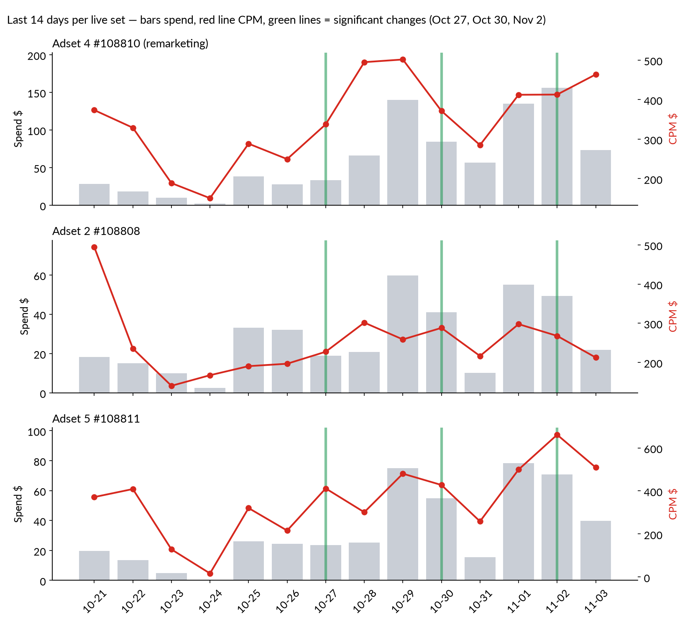

# Stage 1 — Blueprint ad sets: exact configuration, audiences, last 14 days, all-time cuts

Account 1459085242361281 · pulled Nov 3 2026 14:30 Israel · every field below is read from the ad set object, the audience object or the Insights API. Nothing inferred.

## 1. Every Blueprint ad set, full configuration

Live sets first, then paused, then the old Blueprint campaigns. Set names are the names in your Ads Manager.

### ecomm Adset 4_All_All_CPM_#108810

ID 52666232368428 · **ACTIVE** · created 2026-09-15 · last edited 2026-11-02 13:35 · last significant edit Oct 28 16:16 UTC

| Setting | Value |
|---|---|
| Daily budget | $139 |
| Optimization / bid | OFFSITE_CONVERSIONS (pixel Purchase) · LOWEST_COST_WITHOUT_CAP |
| Attribution | 7d click through + 1d view through + 1d engaged video view |
| Advantage+ audience | OFF |
| Ages / gender | 25–65+ · all |
| Geo | 34 US states |
| Interests | none |
| Engaged Shoppers | no |
| Household income | none |
| Stack logic | — |
| Placements | Manual — FB: feed, facebook_reels · IG: stream, reels |
| Devices | mobile, desktop |
| Included custom audiences | Website Visitors - 30 Days [<1,000 (Meta hides)]; Website Visitors - 90 Days [3,000–3,600]; InitiateCheckout - 30 Days [<1,000 (Meta hides)]; InitiateCheckout - 90 Days [<1,000 (Meta hides)]; ATC - 90 Days [<1,000 (Meta hides)]; ATC - 30 Days [<1,000 (Meta hides)]; People who opened but didn't submit form - 90 Days [7,800–9,100]; Lead 30 days [<1,000 (Meta hides)]; Lead 90 days [<1,000 (Meta hides)]; FB Page - Highly engaged video viewers -  365 Days [1,400–1,600]; Camaign - Highly engaged video viewers - 365 Days [16,300–19,200] |
| Excluded custom audiences | none |
| Estimated audience (Meta MAU) | 28–32k |
| Ads active now | Ad#3 - Video | 75 Sec | Courtney | 10.08.26, Ad#3 static | Courtney | 03.08.26 |
| Ads total in set | 8 |

### ecomm Adset 2_All_All_CPM_#108808

ID 52669013718628 · **ACTIVE** · created 2026-09-28 · last edited 2026-10-30 07:05 · last significant edit Oct 30 07:05 UTC

| Setting | Value |
|---|---|
| Daily budget | $39 |
| Optimization / bid | OFFSITE_CONVERSIONS (pixel Purchase) · LOWEST_COST_WITHOUT_CAP |
| Attribution | 7d click through + 1d view through |
| Advantage+ audience | OFF |
| Ages / gender | 45–64 · all |
| Geo | US (whole country) |
| Interests | 41: Apple Watch, Wearable technology, Human nutrition, Fitbit, Prevention (magazine), Walking, Healthy Habits, Sauna, High-intensity interval training, Pilates, Magnesium, TED (conference), Creatine, Physical fitness, Audiobook, Oprah Winfrey, Distance education, Genetics, Metabolism, Web conferencing, Life extension, PayPal, Healthy diet, Self-help, Continuing education, Non-fiction books, Paleolithic diet, Master class, Probiotic, Udemy, Ketone, Meditations, Strength training, Personal development, Collagen, Omega, Turmeric, Audible.com, Well-being, MyFitnessPal, Vitamins and nutritional supplements |
| Engaged Shoppers | YES |
| Household income | top 10%, 10–25% |
| Stack logic | interests AND (shoppers/income) |
| Placements | Manual — FB: feed, facebook_reels · IG: stream, reels |
| Devices | mobile, desktop |
| Included custom audiences | none |
| Excluded custom audiences | none |
| Estimated audience (Meta MAU) | 40.3–47.4M |
| Ads active now | Ad#6- static | Julie | 03.08.26, Ad#3 static | Courtney | 03.08.26, Ad#12 - Video | 65 Sec | Julie | 13.08.26 |
| Ads total in set | 8 |

### ecomm Adset 5_All_All_CPM_#108811

ID 52669048300628 · **ACTIVE** · created 2026-09-28 · last edited 2026-10-30 07:05 · last significant edit Oct 30 07:05 UTC

| Setting | Value |
|---|---|
| Daily budget | $45 |
| Optimization / bid | OFFSITE_CONVERSIONS (pixel Purchase) · LOWEST_COST_WITHOUT_CAP |
| Attribution | 7d click through + 1d view through |
| Advantage+ audience | OFF |
| Ages / gender | 45–64 · all |
| Geo | US (whole country) |
| Interests | 41: Apple Watch, Wearable technology, Human nutrition, Fitbit, Prevention (magazine), Walking, Healthy Habits, Sauna, High-intensity interval training, Pilates, Magnesium, TED (conference), Creatine, Physical fitness, Audiobook, Oprah Winfrey, Distance education, Genetics, Metabolism, Web conferencing, Life extension, PayPal, Healthy diet, Self-help, Continuing education, Non-fiction books, Paleolithic diet, Master class, Probiotic, Udemy, Ketone, Meditations, Strength training, Personal development, Collagen, Omega, Turmeric, Audible.com, Well-being, MyFitnessPal, Vitamins and nutritional supplements |
| Engaged Shoppers | YES |
| Household income | top 10%, 10–25% |
| Stack logic | interests AND (shoppers/income) |
| Placements | Manual — FB: feed, facebook_reels · IG: stream, reels |
| Devices | mobile, desktop |
| Included custom audiences | none |
| Excluded custom audiences | none |
| Estimated audience (Meta MAU) | 40.3–47.4M |
| Ads active now | Ad#12 - Video | 65 Sec | Julie | 13.08.26 |
| Ads total in set | 2 |

### Blueprint | LAL 1% US purchasers (Masterclass buyers seed, 2.3-2.7M) | 45-65 | Purchase_All_All_CPM_#108779

ID 52676923495628 · **PAUSED** · created 2026-10-30 · last edited 2026-10-30 07:06 · last significant edit —

| Setting | Value |
|---|---|
| Daily budget | $99 |
| Optimization / bid | OFFSITE_CONVERSIONS (pixel Purchase) · LOWEST_COST_WITHOUT_CAP |
| Attribution | 7d click through |
| Advantage+ audience | OFF |
| Ages / gender | 45–65+ · all |
| Geo | 30 US states |
| Interests | none |
| Engaged Shoppers | no |
| Household income | none |
| Stack logic | — |
| Placements | Advantage+ placements (all automatic) |
| Devices | all |
| Included custom audiences | Julie Masterclass | CRM paid buyers 101 | Lookalike 2% US | 2026-10-21 (actually 1%, unused) [2,100,000–2,500,000] |
| Excluded custom audiences | Julie Masterclass | CRM paid buyers 101 | launch-2026-10-18 [<1,000 (Meta hides)] |
| Estimated audience (Meta MAU) | 1.7–2.0M |
| Ads active now | none |
| Ads total in set | 0 |

### ecomm Adset 2_All_All_CPM_#108808

ID 52663512093428 · **PAUSED** · created 2026-09-03 · last edited 2026-09-28 15:06 · last significant edit Sep 22 23:24 UTC

| Setting | Value |
|---|---|
| Daily budget | $160 |
| Optimization / bid | OFFSITE_CONVERSIONS (pixel Purchase) · LOWEST_COST_WITHOUT_CAP |
| Attribution | 1d click through |
| Advantage+ audience | OFF |
| Ages / gender | 35–64 · all |
| Geo | 34 US states |
| Interests | 11: Wearable technology, Bulletproof, Physical fitness, Life extension, Healthy diet, Weight training, Bodybuilding, Meditations, Personal development, High-net-worth individual, Vitamins and nutritional supplements |
| Engaged Shoppers | no |
| Household income | top 5%, top 10% |
| Stack logic | interests OR income, same group |
| Placements | Advantage+ placements (all automatic) |
| Devices | all |
| Included custom audiences | none |
| Excluded custom audiences | none |
| Estimated audience (Meta MAU) | 69.7–82.0M |
| Ads active now | none |
| Ads total in set | 8 |

### ecomm Adset 5_All_All_CPM_#108811

ID 52666296222628 · **PAUSED** · created 2026-09-15 · last edited 2026-09-28 15:06 · last significant edit Sep 18 07:23 UTC

| Setting | Value |
|---|---|
| Daily budget | $40 |
| Optimization / bid | OFFSITE_CONVERSIONS (pixel Purchase) · LOWEST_COST_WITHOUT_CAP |
| Attribution | 7d click through + 1d view through + 1d engaged video view |
| Advantage+ audience | OFF |
| Ages / gender | 35–64 · all |
| Geo | 34 US states |
| Interests | none |
| Engaged Shoppers | no |
| Household income | none |
| Stack logic | — |
| Placements | Manual — FB: feed, story, facebook_reels, facebook_reels_overlay, profile_feed · IG: stream, story, reels, profile_feed |
| Devices | mobile · OS ['iOS'] |
| Included custom audiences | none |
| Excluded custom audiences | none |
| Estimated audience (Meta MAU) | 72.5–85.4M |
| Ads active now | none |
| Ads total in set | 2 |

### ecomm Adset 1_All_All_CPM_#108807

ID 52663511359228 · **PAUSED** · created 2026-09-03 · last edited 2026-09-16 19:21 · last significant edit Sep 16 19:20 UTC

| Setting | Value |
|---|---|
| Daily budget | $1 |
| Optimization / bid | OFFSITE_CONVERSIONS (pixel Purchase) · LOWEST_COST_WITHOUT_CAP |
| Attribution | 1d click through |
| Advantage+ audience | ON (individual: {'age': 1, 'gender': 1, 'geo': 0}) |
| Ages / gender | 18–65+ · all |
| Geo | 34 US states |
| Interests | 11: Wearable technology, Bulletproof, Physical fitness, Life extension, Healthy diet, Weight training, Bodybuilding, Meditations, Personal development, High-net-worth individual, Vitamins and nutritional supplements |
| Engaged Shoppers | no |
| Household income | top 5%, top 10% |
| Stack logic | interests OR income, same group |
| Placements | Advantage+ placements (all automatic) |
| Devices | all |
| Included custom audiences | none |
| Excluded custom audiences | none |
| Estimated audience (Meta MAU) | 72.1–84.8M |
| Ads active now | none |
| Ads total in set | 7 |

### ecomm Adset 3_All_All_CPM_#108809

ID 52664534627228 · **PAUSED** · created 2026-09-08 · last edited 2026-09-16 19:21 · last significant edit Sep 16 19:20 UTC

| Setting | Value |
|---|---|
| Daily budget | $100 |
| Optimization / bid | OFFSITE_CONVERSIONS (pixel Purchase) · LOWEST_COST_WITHOUT_CAP |
| Attribution | 1d click through |
| Advantage+ audience | ON (individual: {'age': 1, 'gender': 1, 'geo': 1}) |
| Ages / gender | 18–65+ · all |
| Geo | 34 US states |
| Interests | none |
| Engaged Shoppers | no |
| Household income | none |
| Stack logic | — |
| Placements | Advantage+ placements (all automatic) |
| Devices | all |
| Included custom audiences | none |
| Excluded custom audiences | none |
| Estimated audience (Meta MAU) | 156.4–184.0M |
| Ads active now | none |
| Ads total in set | 6 |

### Adset 4_All_All_CPM_#108776

ID 52658911189028 · **CAMPAIGN_PAUSED** · created 2026-08-13 · last edited 2026-10-08 08:40 · last significant edit Oct 05 07:39 UTC

| Setting | Value |
|---|---|
| Daily budget | $21 |
| Optimization / bid | OFFSITE_CONVERSIONS (pixel Purchase) · LOWEST_COST_WITHOUT_CAP |
| Attribution | 7d click through + 1d view through |
| Advantage+ audience | OFF (individual: {'age': 1, 'gender': 1, 'geo': 1}) |
| Ages / gender | 18–65+ · all |
| Geo | 34 US states |
| Interests | 12: Wearable technology, Bulletproof, Health & wellness, Physical fitness, Life extension, Healthy diet, Weight training, Bodybuilding, Meditations, Personal development, High-net-worth individual, Vitamins and nutritional supplements |
| Engaged Shoppers | no |
| Household income | top 5%, top 10%, 10–25%, 25–50% |
| Stack logic | interests AND (shoppers/income) |
| Placements | Advantage+ placements (all automatic) |
| Devices | all |
| Included custom audiences | none |
| Excluded custom audiences | none |
| Estimated audience (Meta MAU) | 74.3–87.4M |
| Ads active now | none |
| Ads total in set | 16 |

### Adset 3_All_All_CPM_#108775

ID 52658911189228 · **CAMPAIGN_PAUSED** · created 2026-08-13 · last edited 2026-10-08 20:06 · last significant edit Oct 05 07:39 UTC

| Setting | Value |
|---|---|
| Daily budget | $33 |
| Optimization / bid | OFFSITE_CONVERSIONS (pixel Purchase) · LOWEST_COST_WITHOUT_CAP |
| Attribution | 7d click through + 1d view through + 1d engaged video view |
| Advantage+ audience | OFF (individual: {'age': 1, 'gender': 1, 'geo': 1}) |
| Ages / gender | 18–65+ · all |
| Geo | 34 US states |
| Interests | 12: Wearable technology, Bulletproof, Health & wellness, Physical fitness, Life extension, Healthy diet, Weight training, Bodybuilding, Meditations, Personal development, High-net-worth individual, Vitamins and nutritional supplements |
| Engaged Shoppers | no |
| Household income | top 5%, top 10%, 10–25%, 25–50% |
| Stack logic | interests OR income, same group |
| Placements | Advantage+ placements (all automatic) |
| Devices | all |
| Included custom audiences | none |
| Excluded custom audiences | none |
| Estimated audience (Meta MAU) | 173.5–204.2M |
| Ads active now | none |
| Ads total in set | 9 |

### Adset 2_All_All_CPM_#108778

ID 52635242453628 · **CAMPAIGN_PAUSED** · created 2026-06-24 · last edited 2026-09-24 06:32 · last significant edit Sep 24 06:32 UTC

| Setting | Value |
|---|---|
| Daily budget | $150 |
| Optimization / bid | OFFSITE_CONVERSIONS (pixel Purchase) · LOWEST_COST_WITHOUT_CAP |
| Attribution | 7d click through + 1d view through |
| Advantage+ audience | OFF (individual: {'age': 0, 'gender': 0, 'geo': 1}) |
| Ages / gender | 25–65+ · all |
| Geo | 30 US states |
| Interests | 12: Wearable technology, Bulletproof, Health & wellness, Physical fitness, Life extension, Healthy diet, Weight training, Bodybuilding, Meditations, Personal development, High-net-worth individual, Vitamins and nutritional supplements |
| Engaged Shoppers | no |
| Household income | top 5%, top 10%, 10–25%, 25–50% |
| Stack logic | interests AND (shoppers/income) |
| Placements | Advantage+ placements (all automatic) |
| Devices | all |
| Included custom audiences | none |
| Excluded custom audiences | none |
| Estimated audience (Meta MAU) | 69.8–82.1M |
| Ads active now | none |
| Ads total in set | 8 |

### Adset 1_All_All_CPM_#108777

ID 52604761655828 · **CAMPAIGN_PAUSED** · created 2026-05-22 · last edited 2026-08-13 09:01 · last significant edit Aug 14 04:49 UTC

| Setting | Value |
|---|---|
| Daily budget | $150 |
| Optimization / bid | OFFSITE_CONVERSIONS (pixel Purchase) · LOWEST_COST_WITHOUT_CAP |
| Attribution | 7d click through + 1d view through + 1d engaged video view |
| Advantage+ audience | OFF (individual: {'age': 0, 'gender': 1, 'geo': 0}) |
| Ages / gender | 35–65+ · all |
| Geo | 30 US states |
| Interests | none |
| Engaged Shoppers | no |
| Household income | none |
| Stack logic | — |
| Placements | Advantage+ placements (all automatic) |
| Devices | all |
| Included custom audiences | none |
| Excluded custom audiences | none |
| Estimated audience (Meta MAU) | 125.8–148.1M |
| Ads active now | none |
| Ads total in set | 8 |

## 2. The audiences in this account: what was fed, what was built, what is used

| Audience | Type | Seed / source | Size | Created / updated | Status | Used by |
|---|---|---|---|---|---|---|
| LLA seed - all Masterclass+Blueprint signups + checkout starters 2026-10-28 | CUSTOM | uploaded customer file | <1,000 (Meta hides) | Oct 28 / Oct 28 | OK | — |
| LLA · Checkout starters 180d | Lookalike 2% US | 2026-10-21 v2 | LOOKALIKE | LAL 2% US of: LLA · Checkout starters 180d · www only (LAL seed) | 4,800,000–5,700,000 | Oct 20 / Oct 20 | OK | #108815 |
| Julie Masterclass | CRM paid buyers 101 | Lookalike 2% US | 2026-10-21 v2 | LOOKALIKE | LAL 2% US of: Julie Masterclass | CRM paid buyers 101 | launch-2026-10-18 | 4,200,000–5,000,000 | Oct 20 / Oct 20 | OK | #108814, #108815 |
| Julie Masterclass | CRM paid buyers 101 | Lookalike 2% US | 2026-10-21 (actually 1%, unused) | LOOKALIKE | LAL 1% US of: Julie Masterclass | CRM paid buyers 101 | launch-2026-10-18 | 2,100,000–2,500,000 | Oct 20 / Oct 20 | OK | #108779 |
| Julie Masterclass | CRM paid purchasers | Lookalike 1% | 2026-10-18 | LOOKALIKE | LAL 1%  of: Julie Masterclass | CRM paid buyers 101 | launch-2026-10-18 | <1,000 (Meta hides) | Oct 18 / Oct 18 | OK | #108814, #108815 |
| Julie campaign52668266203628 ONLY | IC30 OR ATC14 | Purchase180 excluded | WEBSITE | website rule | <1,000 (Meta hides) | Oct 18 / Oct 18 | OK | #108814 |
| Julie Masterclass | Purchase180 | exclusion | WEBSITE | website rule | <1,000 (Meta hides) | Oct 18 / Oct 18 | OK | EXCL in #108814 |
| Julie Masterclass | CRM paid buyers 101 | launch-2026-10-18 | CUSTOM | uploaded customer file | <1,000 (Meta hides) | Oct 18 / Oct 30 | OK | EXCL in #108779, EXCL in #108814 |
| LLA · LAL 1% US · Julie video 75% viewers | LOOKALIKE | LAL 1% US of: LLA · Julie video 75% viewers 365d (LAL seed) | <1,000 (Meta hides) | Oct 02 / Oct 02 | **FAILED: We couldn't create your lookalike audience. Please delete th** | #108814 |
| LLA · LAL 1% US · Masterclass page viewers + top 25% time | LOOKALIKE | LAL 1% US of: LLA · Masterclass page viewers 180d + top 25% time (LAL seed) | 2,200,000–2,600,000 | Oct 02 / Oct 02 | OK | #108814 |
| LLA · LAL 1% US · Checkout starters 180d | LOOKALIKE | LAL 1% US of: LLA · Checkout starters 180d · www only (LAL seed) | 2,400,000–2,800,000 | Oct 02 / Oct 02 | OK | #108814, #108815 |
| LLA · Masterclass page viewers 180d + top 25% time (LAL seed) | WEBSITE | website rule | <1,000 (Meta hides) | Oct 02 / Oct 02 | OK | — |
| LLA · Julie video 75% viewers 365d (LAL seed) | ENGAGEMENT | engagement rule | <1,000 (Meta hides) | Oct 02 / Oct 02 | OK | — |
| LLA · Checkout starters 180d · www only (LAL seed) | WEBSITE | website rule | <1,000 (Meta hides) | Oct 02 / Oct 02 | OK | — |
| Camaign - Highly engaged video viewers - 365 Days | ENGAGEMENT | engagement rule | 16,300–19,200 | Sep 18 / Nov 03 | OK | #108810, #108814 |
| FB Page - Highly engaged video viewers -  365 Days | ENGAGEMENT | engagement rule | 1,400–1,600 | Sep 18 / Nov 02 | OK | #108810, #108814 |
| Lead 90 days | WEBSITE | website rule | <1,000 (Meta hides) | Sep 18 / Sep 18 | OK | #108810, #108814 |
| Lead 30 days | WEBSITE | website rule | <1,000 (Meta hides) | Sep 18 / Sep 18 | OK | #108810, #108814 |
| Page View - 90 days | WEBSITE | website rule | 3,000–3,600 | Sep 18 / Sep 18 | OK | — |
| Page View - 30 days | WEBSITE | website rule | <1,000 (Meta hides) | Sep 18 / Sep 18 | OK | — |
| People who opened but didn't submit form - 90 Days | ENGAGEMENT | engagement rule | 7,800–9,100 | Sep 18 / Sep 18 | OK | #108810, #108814 |
| Lookalike (1%) - Purchase - 30 Days | LOOKALIKE | LAL 1%  of: Purchase - 30 Days | <1,000 (Meta hides) | Sep 14 / Sep 14 | **FAILED: We couldn't create your lookalike audience. Please delete th** | — |
| Purchase - 30 Days | WEBSITE | website rule | <1,000 (Meta hides) | Sep 14 / Sep 14 | OK | EXCL in #108815, EXCL in #108817, EXCL in #108818 |
| Lookalike (1%) - ATC - 30 Days | LOOKALIKE | LAL 1%  of: ATC - 30 Days | <1,000 (Meta hides) | Sep 14 / Sep 14 | OK | — |
| ATC - 30 Days | WEBSITE | website rule | <1,000 (Meta hides) | Sep 14 / Sep 14 | OK | #108810, #108814 |
| Lookalike (1%) - ATC - 90 Days | LOOKALIKE | LAL 1%  of: ATC - 90 Days | <1,000 (Meta hides) | Sep 14 / Sep 14 | OK | — |
| ATC - 90 Days | WEBSITE | website rule | <1,000 (Meta hides) | Sep 14 / Sep 14 | OK | #108810, #108814 |
| InitiateCheckout - 90 Days | WEBSITE | website rule | <1,000 (Meta hides) | Sep 14 / Sep 14 | OK | #108810, #108814 |
| InitiateCheckout - 30 Days | WEBSITE | website rule | <1,000 (Meta hides) | Sep 14 / Sep 14 | OK | #108810, #108814 |
| Website Visitors - 90 Days | WEBSITE | website rule | 3,000–3,600 | Sep 14 / Sep 14 | OK | #108810, #108814 |
| Website Visitors - 30 Days | WEBSITE | website rule | <1,000 (Meta hides) | Sep 14 / Sep 14 | OK | #108810, #108814 |

Facts to hold onto:
- Two customer files were uploaded: **"Julie Masterclass | CRM paid buyers 101"** (Oct 18, re-uploaded Oct 30) and **"LLA seed – all Masterclass+Blueprint signups + checkout starters"** (Oct 28). Meta hides exact match counts under 1,000, so the API cannot show how many rows matched.
- Lookalikes built from the buyers file: 1% (Oct 18, the "CRM paid purchasers | Lookalike 1%" whose size reads <1,000 = not populated), 1% US (Oct 20, 2.1–2.5M, named "2% … (actually 1%)"), 2% US (Oct 20, 4.2–5.0M). From checkout starters 180d: 1% US (2.4–2.8M) and 2% US (4.8–5.7M). From Masterclass page viewers: 1% US (2.2–2.6M).
- **No lookalike was ever built from the Oct 28 "all signups + checkout starters" file.**
- Two lookalikes **failed** to build: "Lookalike (1%) – Purchase – 30 Days" (Sep 14) and "LAL 1% US – Julie video 75% viewers" (Oct 2). Seeds too small.
- **In the Blueprint campaign, no live set uses any list or lookalike except Adset 4** (11 pixel/engagement lists, no buyer list, no exclusion). The only Blueprint set with a purchaser lookalike is #108779 (LAL 1% US buyers, 1.7–2.0M, 45–65+, buyers excluded), created Oct 30, paused, **no ads were ever attached**.
## 3. Last 14 days (Oct 21 – Nov 3), day by day, per live set

Columns: spend · impressions · CPM · landing page views · cost per landing page view · carts · checkouts · purchases. Rows marked 🟩 are days with a significant change to the set (budget, ads, targeting), read from the objects' edit timestamps; the day after a 🟩 row starts a new learning period.

### Adset 4 #108810 (remarketing) — ecomm Adset 4_All_All_CPM_#108810

| Day | Spend | Impr. | CPM | LPV | $/LPV | Carts | Checkouts | Purchases | Change |
|---|---:|---:|---:|---:|---:|---:|---:|---:|---|
| 10-21 | $28 | 76 | $374 | 2 | $14 | 0 | 0 | 0 |  |
| 10-22 | $18 | 55 | $329 | 0 | — | 0 | 0 | 0 |  |
| 10-23 | $10 | 53 | $189 | 1 | $10 | 1 | 0 | 0 |  |
| 10-24 | $2 | 15 | $151 | 0 | — | 0 | 0 | 0 |  |
| 10-25 | $38 | 132 | $289 | 2 | $19 | 0 | 0 | 0 |  |
| 10-26 | $28 | 111 | $250 | 1 | $28 | 0 | 0 | 0 |  |
| 10-27 | $33 | 98 | $338 | 2 | $17 | 1 | 0 | 0 | 🟩 Adset 2 and 5: last significant edit Oct 27 09:05 UTC (learning reset) |
| 10-28 | $66 | 133 | $495 | 5 | $13 | 1 | 1 | 1 |  |
| 10-29 | $140 | 279 | $502 | 5 | $28 | 0 | 0 | 0 |  |
| 10-30 | $84 | 227 | $371 | 6 | $14 | 0 | 0 | 0 | 🟩 Oct 30 07:05 UTC: budgets set ($39 / $45 / $139), ads paused/activated in all three sets, LAL set #108779 created, buyers list re-uploaded |
| 10-31 | $56 | 198 | $285 | 3 | $19 | 0 | 0 | 0 |  |
| 11-01 | $135 | 327 | $412 | 5 | $27 | 0 | 0 | 0 |  |
| 11-02 | $156 | 378 | $413 | 14 | $11 | 0 | 0 | 0 | 🟩 Nov 2 13:35 UTC: Adset 4 edited (ads paused: Courtney static #2, Julie video); Adset 2: Julie static re-activated |
| 11-03 | $73 | 158 | $464 | 1 | $73 | 0 | 0 | 0 |  |
| **14-day total** | **$868** | **2,240** | **$388** | **47** | **$18** | **3** | **1** | **1** | link clicks 53 |

### Adset 2 #108808 — ecomm Adset 2_All_All_CPM_#108808

| Day | Spend | Impr. | CPM | LPV | $/LPV | Carts | Checkouts | Purchases | Change |
|---|---:|---:|---:|---:|---:|---:|---:|---:|---|
| 10-21 | $18 | 37 | $494 | 0 | — | 0 | 0 | 0 |  |
| 10-22 | $15 | 64 | $235 | 0 | — | 0 | 0 | 0 |  |
| 10-23 | $10 | 70 | $140 | 4 | $2 | 0 | 0 | 0 |  |
| 10-24 | $3 | 15 | $167 | 0 | — | 0 | 0 | 0 |  |
| 10-25 | $33 | 174 | $190 | 2 | $17 | 0 | 0 | 0 |  |
| 10-26 | $32 | 163 | $197 | 2 | $16 | 0 | 0 | 0 |  |
| 10-27 | $19 | 83 | $227 | 1 | $19 | 0 | 0 | 0 | 🟩 Adset 2 and 5: last significant edit Oct 27 09:05 UTC (learning reset) |
| 10-28 | $21 | 69 | $302 | 0 | — | 0 | 0 | 0 |  |
| 10-29 | $60 | 231 | $259 | 5 | $12 | 0 | 0 | 0 |  |
| 10-30 | $41 | 142 | $288 | 0 | — | 0 | 0 | 0 | 🟩 Oct 30 07:05 UTC: budgets set ($39 / $45 / $139), ads paused/activated in all three sets, LAL set #108779 created, buyers list re-uploaded |
| 10-31 | $10 | 47 | $216 | 0 | — | 0 | 0 | 0 |  |
| 11-01 | $55 | 185 | $298 | 6 | $9 | 0 | 0 | 0 |  |
| 11-02 | $49 | 184 | $268 | 4 | $12 | 0 | 0 | 0 | 🟩 Nov 2 13:35 UTC: Adset 4 edited (ads paused: Courtney static #2, Julie video); Adset 2: Julie static re-activated |
| 11-03 | $22 | 103 | $213 | 2 | $11 | 0 | 0 | 0 |  |
| **14-day total** | **$388** | **1,567** | **$247** | **26** | **$15** | **0** | **0** | **0** | link clicks 34 |

### Adset 5 #108811 — ecomm Adset 5_All_All_CPM_#108811

| Day | Spend | Impr. | CPM | LPV | $/LPV | Carts | Checkouts | Purchases | Change |
|---|---:|---:|---:|---:|---:|---:|---:|---:|---|
| 10-21 | $20 | 53 | $372 | 1 | $20 | 0 | 0 | 0 |  |
| 10-22 | $13 | 33 | $409 | 0 | — | 0 | 0 | 0 |  |
| 10-23 | $5 | 38 | $128 | 1 | $5 | 0 | 0 | 0 |  |
| 10-24 | $0 | 3 | $17 | 0 | — | 0 | 0 | 0 |  |
| 10-25 | $26 | 81 | $320 | 1 | $26 | 0 | 0 | 0 |  |
| 10-26 | $24 | 113 | $216 | 1 | $24 | 0 | 0 | 0 |  |
| 10-27 | $23 | 57 | $412 | 0 | — | 0 | 0 | 0 | 🟩 Adset 2 and 5: last significant edit Oct 27 09:05 UTC (learning reset) |
| 10-28 | $25 | 84 | $301 | 5 | $5 | 0 | 0 | 0 |  |
| 10-29 | $75 | 156 | $480 | 2 | $37 | 0 | 0 | 0 |  |
| 10-30 | $55 | 128 | $428 | 3 | $18 | 0 | 0 | 0 | 🟩 Oct 30 07:05 UTC: budgets set ($39 / $45 / $139), ads paused/activated in all three sets, LAL set #108779 created, buyers list re-uploaded |
| 10-31 | $16 | 60 | $258 | 0 | — | 0 | 0 | 0 |  |
| 11-01 | $78 | 157 | $499 | 5 | $16 | 0 | 0 | 0 |  |
| 11-02 | $71 | 107 | $661 | 1 | $71 | 1 | 0 | 0 | 🟩 Nov 2 13:35 UTC: Adset 4 edited (ads paused: Courtney static #2, Julie video); Adset 2: Julie static re-activated |
| 11-03 | $40 | 78 | $509 | 1 | $40 | 0 | 0 | 0 |  |
| **14-day total** | **$471** | **1,148** | **$410** | **21** | **$22** | **1** | **0** | **0** | link clicks 22 |

### 14-day summary

| Set | Est. audience | Spend | CPM | Link clicks | LPV | $/LPV | Carts | Checkouts | Purchases |
|---|---|---:|---:|---:|---:|---:|---:|---:|---:|
| Adset 4 #108810 (remarketing) | 27.6–32.5k | $868 | $388 | 53 | 47 | $18 | 3 | 1 | 1 |
| Adset 2 #108808 | 40.3–47.4M | $388 | $247 | 34 | 26 | $15 | 0 | 0 | 0 |
| Adset 5 #108811 | 40.3–47.4M | $471 | $410 | 22 | 21 | $22 | 1 | 0 | 0 |
| LAL set #108779 | 1.7–2.0M | $0 | — | — | — | — | — | — | never ran |
## 4. All-time Blueprint money: where it went and what it brought, per ad set

Period: each set's full life (oldest set May 22 2026). Columns: spend, CPM, link clicks, landing page views, cost per LPV, carts, checkouts, purchases, cost per purchase. Adset 4's Sep 20–26 QA test-device events (men 35–44: 43 carts, 24 checkouts) are inside the numbers where Meta cannot split them out and are flagged in the row.

### All Blueprint sets combined, all time — $35,513 · 17,281 clicks · 15,980 LPV · 488 carts (43 are QA tests) · 49 checkouts (24 are QA tests) · 4 purchases

**By placement**

| Segment | Spend | CPM | Link clicks | LPV | $/LPV | Carts | Checkouts | Purchases | $/purchase |
|---|---|---|---|---|---|---|---|---|---|
| FB Feed | $14,828 | $35 | 6,107 | 5,900 | $3 | 102 | 15 | 2 | $7,414 |
| FB Reels | $6,959 | $96 | 4,025 | 3,646 | $2 | 101 | 11 | 1 | $6,959 |
| facebook facebook_stories | $4,820 | $376 | 2,173 | 1,915 | $3 | 163 | 7 | 0 | — |
| instagram feed | $2,746 | $319 | 406 | 385 | $7 | 16 | 3 | 1 | $2,746 |
| instagram instagram_reels | $1,943 | $182 | 661 | 602 | $3 | 28 | 0 | 0 | — |
| FB In-stream | $1,537 | $97 | 1,362 | 1,325 | $1 | 21 | 3 | 0 | — |
| FB Reels overlay | $734 | $37 | 423 | 381 | $2 | 33 | 7 | 0 | — |
| instagram instagram_stories | $652 | $177 | 143 | 131 | $5 | 3 | 1 | 0 | — |
| Audience Network | $523 | $16 | 630 | 446 | $1 | 6 | 0 | 0 | — |
| Threads | $336 | $27 | 1,222 | 1,110 | $0 | 8 | 1 | 0 | — |
| facebook facebook_profile_feed | $217 | $220 | 39 | 36 | $6 | 3 | 1 | 0 | — |
| Unknown | $89 | $248 | 9 | 40 | $2 | 0 | 0 | 0 | — |
| FB Marketplace | $63 | $59 | 24 | 22 | $3 | 0 | 0 | 0 | — |
| facebook facebook_notification | $27 | $193 | 15 | 11 | $2 | 4 | 0 | 0 | — |
| audience_network rewarded_video | $21 | $76 | 39 | 28 | $1 | 0 | 0 | 0 | — |

**By gender × age** (Men 35–44 = QA test device)

| Segment | Spend | CPM | Link clicks | LPV | $/LPV | Carts | Checkouts | Purchases | $/purchase |
|---|---|---|---|---|---|---|---|---|---|
| Women 65+ | $11,138 | $108 | 7,218 | 6,645 | $2 | 291 | 12 | 0 | — |
| Women 55-64 | $8,146 | $65 | 3,065 | 2,843 | $3 | 61 | 5 | 1 | $8,146 |
| Women 45-54 | $4,369 | $45 | 1,630 | 1,574 | $3 | 29 | 4 | 1 | $4,369 |
| Men 65+ | $3,466 | $97 | 1,920 | 1,676 | $2 | 38 | 1 | 0 | — |
| Men 55-64 | $2,956 | $70 | 900 | 798 | $4 | 11 | 1 | 0 | — |
| Women 35-44 | $2,343 | $20 | 1,412 | 1,392 | $2 | 4 | 1 | 1 | $2,343 |
| Men 45-54 | $1,314 | $41 | 462 | 431 | $3 | 6 | 1 | 1 | $1,314 |
| Men 35-44 | $815 | $24 | 394 | 381 | $2 | 44 | 24 | 0 | — |
| Women 25-34 | $314 | $34 | 86 | 69 | $5 | 0 | 0 | 0 | — |
| Unknown 65+ | $160 | $203 | 63 | 54 | $3 | 1 | 0 | 0 | — |
| Men 25-34 | $125 | $23 | 38 | 23 | $5 | 0 | 0 | 0 | — |
| Unknown 35-44 | $108 | $28 | 29 | 22 | $5 | 0 | 0 | 0 | — |
| Unknown 55-64 | $102 | $83 | 24 | 21 | $5 | 0 | 0 | 0 | — |
| Unknown 45-54 | $73 | $37 | 19 | 15 | $5 | 0 | 0 | 0 | — |
| Men 18-24 | $30 | $12 | 11 | 7 | $4 | 0 | 0 | 0 | — |
| Women 18-24 | $27 | $11 | 6 | 4 | $7 | 2 | 0 | 0 | — |
| Unknown 25-34 | $25 | $23 | 4 | 4 | $6 | 0 | 0 | 0 | — |

**By device**

| Segment | Spend | CPM | Link clicks | LPV | $/LPV | Carts | Checkouts | Purchases | $/purchase |
|---|---|---|---|---|---|---|---|---|---|
| mobile_app / iphone | $26,231 | $59 | 11,300 | 10,977 | $2 | 405 | 37 | 3 | $8,744 |
| mobile_app / android_smartphone | $6,271 | $46 | 4,177 | 3,429 | $2 | 52 | 4 | 1 | $6,271 |
| mobile_app / ipad | $1,556 | $112 | 988 | 930 | $2 | 19 | 2 | 0 | — |
| desktop / desktop | $651 | $93 | 118 | 80 | $8 | 9 | 5 | 0 | — |
| mobile_app / desktop | $326 | $44 | 454 | 317 | $1 | 0 | 0 | 0 | — |
| mobile_app / android_tablet | $147 | $69 | 113 | 98 | $2 | 2 | 1 | 0 | — |
| mobile_web / iphone | $96 | $51 | 31 | 27 | $4 | 1 | 0 | 0 | — |
| unknown / other | $89 | $248 | 9 | 40 | $2 | 0 | 0 | 0 | — |
| mobile_web / android_smartphone | $80 | $61 | 33 | 29 | $3 | 0 | 0 | 0 | — |
| mobile_app / other | $63 | $75 | 57 | 52 | $1 | 0 | 0 | 0 | — |

### ecomm Adset 4_All_All_CPM_#108810 — ACTIVE

25–65+ · all genders · Advantage+ audience OFF · 11 lists (remarketing) · manual placements

**Total: $4,161 · CPM $278 · 289 clicks · 249 LPV · 57 carts · 25 checkouts · 2 purchases**

**By placement**

| Segment | Spend | CPM | Link clicks | LPV | $/LPV | Carts | Checkouts | Purchases | $/purchase |
|---|---|---|---|---|---|---|---|---|---|
| FB Feed | $2,161 | $267 | 145 | 128 | $17 | 35 | 12 | 1 | $2,161 |
| FB Reels | $631 | $398 | 33 | 28 | $23 | 7 | 6 | 1 | $631 |
| instagram feed | $624 | $531 | 30 | 27 | $23 | 5 | 1 | 0 | — |
| instagram instagram_reels | $235 | $494 | 12 | 11 | $21 | 0 | 0 | 0 | — |
| instagram instagram_stories | $148 | $825 | 8 | 4 | $37 | 2 | 1 | 0 | — |
| facebook facebook_stories | $111 | $634 | 8 | 9 | $12 | 1 | 0 | 0 | — |
| FB In-stream | $79 | $259 | 8 | 6 | $13 | 0 | 0 | 0 | — |
| FB Reels overlay | $40 | $34 | 16 | 13 | $3 | 6 | 5 | 0 | — |
| Audience Network | $40 | $56 | 19 | 14 | $3 | 1 | 0 | 0 | — |
| Unknown | $29 | $391 | 0 | 0 | — | 0 | 0 | 0 | — |
| FB Marketplace | $28 | $64 | 5 | 6 | $5 | 0 | 0 | 0 | — |
| facebook facebook_profile_feed | $20 | $306 | 0 | 0 | — | 0 | 0 | 0 | — |

**By gender × age** Men 35–44 here = QA test device.

| Segment | Spend | CPM | Link clicks | LPV | $/LPV | Carts | Checkouts | Purchases | $/purchase |
|---|---|---|---|---|---|---|---|---|---|
| Women 55-64 | $1,464 | $291 | 102 | 90 | $16 | 9 | 1 | 1 | $1,464 |
| Women 45-54 | $792 | $278 | 42 | 37 | $21 | 3 | 1 | 0 | — |
| Men 55-64 | $552 | $251 | 36 | 33 | $17 | 2 | 0 | 0 | — |
| Women 65+ | $393 | $402 | 27 | 23 | $17 | 1 | 0 | 0 | — |
| Men 65+ | $343 | $308 | 36 | 24 | $14 | 1 | 1 | 0 | — |
| Women 35-44 | $253 | $235 | 25 | 23 | $11 | 2 | 1 | 1 | $253 |
| Men 45-54 | $182 | $202 | 11 | 9 | $20 | 2 | 0 | 0 | — |
| Men 35-44 | $120 | $189 | 6 | 6 | $20 | 37 | 21 | 0 | — |
| Unknown 55-64 | $18 | $334 | 0 | 0 | — | 0 | 0 | 0 | — |
| Unknown 65+ | $16 | $2,703 | 1 | 1 | $16 | 0 | 0 | 0 | — |
| Women 25-34 | $13 | $577 | 0 | 0 | — | 0 | 0 | 0 | — |

**By device**

| Segment | Spend | CPM | Link clicks | LPV | $/LPV | Carts | Checkouts | Purchases | $/purchase |
|---|---|---|---|---|---|---|---|---|---|
| mobile_app / iphone | $3,191 | $298 | 224 | 196 | $16 | 49 | 17 | 1 | $3,191 |
| mobile_app / android_smartphone | $613 | $206 | 54 | 45 | $14 | 5 | 3 | 1 | $613 |
| desktop / desktop | $161 | $200 | 5 | 3 | $54 | 3 | 5 | 0 | — |
| mobile_app / ipad | $135 | $470 | 4 | 3 | $45 | 0 | 0 | 0 | — |
| unknown / other | $29 | $391 | 0 | 0 | — | 0 | 0 | 0 | — |
| mobile_web / iphone | $16 | $346 | 2 | 2 | $8 | 0 | 0 | 0 | — |
| mobile_web / android_smartphone | $14 | $410 | 0 | 0 | — | 0 | 0 | 0 | — |

### ecomm Adset 2_All_All_CPM_#108808 — ACTIVE

45–64 · all genders · Advantage+ audience OFF · 41 interests + Engaged Shoppers + income top 10%/top 10%-25% · manual placements

**Total: $1,784 · CPM $45 · 557 clicks · 448 LPV · 4 carts · 0 checkouts · 0 purchases**

**By placement**

| Segment | Spend | CPM | Link clicks | LPV | $/LPV | Carts | Checkouts | Purchases | $/purchase |
|---|---|---|---|---|---|---|---|---|---|
| FB Feed | $1,241 | $35 | 513 | 413 | $3 | 4 | 0 | 0 | — |
| instagram feed | $193 | $356 | 15 | 11 | $18 | 0 | 0 | 0 | — |
| FB Reels | $146 | $313 | 8 | 8 | $18 | 0 | 0 | 0 | — |
| instagram instagram_reels | $69 | $192 | 3 | 1 | $69 | 0 | 0 | 0 | — |
| facebook facebook_stories | $40 | $1,756 | 1 | 1 | $40 | 0 | 0 | 0 | — |
| instagram instagram_stories | $33 | $334 | 0 | 0 | — | 0 | 0 | 0 | — |
| FB Reels overlay | $12 | $31 | 4 | 4 | $3 | 0 | 0 | 0 | — |
| FB In-stream | $12 | $215 | 2 | 2 | $6 | 0 | 0 | 0 | — |

**By gender × age**

| Segment | Spend | CPM | Link clicks | LPV | $/LPV | Carts | Checkouts | Purchases | $/purchase |
|---|---|---|---|---|---|---|---|---|---|
| Women 55-64 | $581 | $73 | 125 | 102 | $6 | 3 | 0 | 0 | — |
| Women 45-54 | $392 | $46 | 131 | 100 | $4 | 0 | 0 | 0 | — |
| Men 55-64 | $380 | $86 | 67 | 51 | $7 | 1 | 0 | 0 | — |
| Men 45-54 | $191 | $56 | 46 | 37 | $5 | 0 | 0 | 0 | — |
| Women 35-44 | $173 | $15 | 149 | 132 | $1 | 0 | 0 | 0 | — |
| Men 35-44 | $49 | $15 | 33 | 24 | $2 | 0 | 0 | 0 | — |

**By device**

| Segment | Spend | CPM | Link clicks | LPV | $/LPV | Carts | Checkouts | Purchases | $/purchase |
|---|---|---|---|---|---|---|---|---|---|
| mobile_app / iphone | $1,347 | $47 | 389 | 319 | $4 | 3 | 0 | 0 | — |
| mobile_app / android_smartphone | $265 | $29 | 155 | 118 | $2 | 0 | 0 | 0 | — |
| desktop / desktop | $111 | $94 | 4 | 3 | $37 | 0 | 0 | 0 | — |
| mobile_app / ipad | $32 | $219 | 5 | 4 | $8 | 1 | 0 | 0 | — |
| mobile_web / iphone | $11 | $155 | 0 | 0 | — | 0 | 0 | 0 | — |

### ecomm Adset 5_All_All_CPM_#108811 — ACTIVE

45–64 · all genders · Advantage+ audience OFF · 41 interests + Engaged Shoppers + income top 10%/top 10%-25% · manual placements

**Total: $1,606 · CPM $39 · 572 clicks · 453 LPV · 3 carts · 0 checkouts · 0 purchases**

**By placement**

| Segment | Spend | CPM | Link clicks | LPV | $/LPV | Carts | Checkouts | Purchases | $/purchase |
|---|---|---|---|---|---|---|---|---|---|
| FB Feed | $892 | $23 | 542 | 422 | $2 | 1 | 0 | 0 | — |
| instagram feed | $286 | $475 | 9 | 7 | $41 | 0 | 0 | 0 | — |
| FB Reels | $237 | $425 | 16 | 18 | $13 | 1 | 0 | 0 | — |
| instagram instagram_reels | $145 | $555 | 4 | 4 | $36 | 0 | 0 | 0 | — |
| FB In-stream | $12 | $336 | 0 | 0 | — | 0 | 0 | 0 | — |
| FB Reels overlay | $10 | $71 | 0 | 0 | — | 1 | 0 | 0 | — |

**By gender × age**

| Segment | Spend | CPM | Link clicks | LPV | $/LPV | Carts | Checkouts | Purchases | $/purchase |
|---|---|---|---|---|---|---|---|---|---|
| Women 55-64 | $621 | $63 | 154 | 128 | $5 | 2 | 0 | 0 | — |
| Women 45-54 | $385 | $39 | 129 | 103 | $4 | 0 | 0 | 0 | — |
| Men 55-64 | $263 | $61 | 86 | 64 | $4 | 0 | 0 | 0 | — |
| Women 35-44 | $157 | $15 | 129 | 104 | $2 | 0 | 0 | 0 | — |
| Men 45-54 | $131 | $35 | 51 | 40 | $3 | 0 | 0 | 0 | — |
| Men 35-44 | $39 | $13 | 20 | 11 | $4 | 1 | 0 | 0 | — |

**By device**

| Segment | Spend | CPM | Link clicks | LPV | $/LPV | Carts | Checkouts | Purchases | $/purchase |
|---|---|---|---|---|---|---|---|---|---|
| mobile_app / iphone | $1,277 | $42 | 394 | 326 | $4 | 3 | 0 | 0 | — |
| mobile_app / android_smartphone | $268 | $26 | 177 | 125 | $2 | 0 | 0 | 0 | — |
| mobile_app / ipad | $25 | $268 | 1 | 1 | $25 | 0 | 0 | 0 | — |
| desktop / desktop | $23 | $112 | 0 | 0 | — | 0 | 0 | 0 | — |

### ecomm Adset 2_All_All_CPM_#108808 — PAUSED

35–64 · all genders · Advantage+ audience OFF · 11 interests + income top 5%/top 10% · Advantage+ placements

**Total: $7,550 · CPM $24 · 4,418 clicks · 4,471 LPV · 16 carts · 4 checkouts · 2 purchases**

**By placement**

| Segment | Spend | CPM | Link clicks | LPV | $/LPV | Carts | Checkouts | Purchases | $/purchase |
|---|---|---|---|---|---|---|---|---|---|
| FB Feed | $5,366 | $19 | 3,110 | 3,312 | $2 | 6 | 1 | 1 | $5,366 |
| instagram feed | $811 | $572 | 56 | 58 | $14 | 7 | 2 | 1 | $811 |
| FB Reels | $442 | $62 | 65 | 53 | $8 | 1 | 0 | 0 | — |
| instagram instagram_reels | $225 | $426 | 13 | 11 | $20 | 0 | 0 | 0 | — |
| facebook facebook_stories | $182 | $283 | 25 | 20 | $9 | 1 | 0 | 0 | — |
| Threads | $159 | $16 | 946 | 871 | $0 | 1 | 1 | 0 | — |
| FB Reels overlay | $99 | $18 | 68 | 53 | $2 | 0 | 0 | 0 | — |
| FB In-stream | $89 | $120 | 23 | 17 | $5 | 0 | 0 | 0 | — |
| instagram instagram_stories | $83 | $545 | 5 | 5 | $17 | 0 | 0 | 0 | — |
| Audience Network | $34 | $6 | 103 | 60 | $1 | 0 | 0 | 0 | — |
| Unknown | $26 | $501 | 1 | 7 | $4 | 0 | 0 | 0 | — |
| facebook facebook_profile_feed | $25 | $119 | 0 | 0 | — | 0 | 0 | 0 | — |

**By gender × age**

| Segment | Spend | CPM | Link clicks | LPV | $/LPV | Carts | Checkouts | Purchases | $/purchase |
|---|---|---|---|---|---|---|---|---|---|
| Women 55-64 | $2,042 | $30 | 1,155 | 1,154 | $2 | 2 | 0 | 0 | — |
| Women 45-54 | $1,481 | $25 | 735 | 806 | $2 | 6 | 2 | 1 | $1,481 |
| Women 35-44 | $1,252 | $15 | 869 | 923 | $1 | 0 | 0 | 0 | — |
| Women 65+ | $936 | $29 | 867 | 782 | $1 | 1 | 0 | 0 | — |
| Men 55-64 | $607 | $37 | 233 | 241 | $3 | 1 | 0 | 0 | — |
| Men 35-44 | $333 | $16 | 198 | 224 | $1 | 4 | 1 | 0 | — |
| Men 45-54 | $330 | $21 | 175 | 190 | $2 | 2 | 1 | 1 | $330 |
| Men 65+ | $321 | $62 | 98 | 79 | $4 | 0 | 0 | 0 | — |
| Women 25-34 | $128 | $29 | 43 | 35 | $4 | 0 | 0 | 0 | — |
| Men 25-34 | $44 | $27 | 14 | 11 | $4 | 0 | 0 | 0 | — |
| Unknown 55-64 | $21 | $39 | 7 | 6 | $4 | 0 | 0 | 0 | — |
| Unknown 45-54 | $15 | $22 | 6 | 6 | $3 | 0 | 0 | 0 | — |
| Unknown 35-44 | $15 | $15 | 10 | 6 | $3 | 0 | 0 | 0 | — |

**By device**

| Segment | Spend | CPM | Link clicks | LPV | $/LPV | Carts | Checkouts | Purchases | $/purchase |
|---|---|---|---|---|---|---|---|---|---|
| mobile_app / iphone | $5,995 | $25 | 3,328 | 3,632 | $2 | 16 | 4 | 2 | $2,998 |
| mobile_app / android_smartphone | $1,215 | $20 | 992 | 753 | $2 | 0 | 0 | 0 | — |
| desktop / desktop | $138 | $89 | 8 | 7 | $20 | 0 | 0 | 0 | — |
| mobile_app / ipad | $138 | $68 | 71 | 61 | $2 | 0 | 0 | 0 | — |
| unknown / other | $26 | $501 | 1 | 7 | $4 | 0 | 0 | 0 | — |
| mobile_web / iphone | $19 | $20 | 1 | 1 | $19 | 0 | 0 | 0 | — |
| mobile_app / android_tablet | $10 | $20 | 9 | 6 | $2 | 0 | 0 | 0 | — |

### ecomm Adset 5_All_All_CPM_#108811 — PAUSED

35–64 · all genders · Advantage+ audience OFF · broad · manual placements

**Total: $1,437 · CPM $153 · 131 clicks · 124 LPV · 5 carts · 2 checkouts · 0 purchases**

**By placement**

| Segment | Spend | CPM | Link clicks | LPV | $/LPV | Carts | Checkouts | Purchases | $/purchase |
|---|---|---|---|---|---|---|---|---|---|
| FB Feed | $808 | $217 | 67 | 64 | $13 | 2 | 0 | 0 | — |
| instagram feed | $277 | $234 | 19 | 19 | $15 | 1 | 0 | 0 | — |
| instagram instagram_stories | $117 | $69 | 15 | 18 | $7 | 0 | 0 | 0 | — |
| FB Reels | $83 | $261 | 5 | 5 | $17 | 0 | 0 | 0 | — |
| instagram instagram_reels | $70 | $34 | 16 | 10 | $7 | 1 | 0 | 0 | — |
| facebook facebook_stories | $47 | $621 | 5 | 6 | $8 | 0 | 0 | 0 | — |
| facebook facebook_profile_feed | $18 | $374 | 1 | 1 | $18 | 0 | 0 | 0 | — |
| FB Reels overlay | $13 | $57 | 3 | 1 | $13 | 1 | 2 | 0 | — |

**By gender × age**

| Segment | Spend | CPM | Link clicks | LPV | $/LPV | Carts | Checkouts | Purchases | $/purchase |
|---|---|---|---|---|---|---|---|---|---|
| Women 55-64 | $476 | $359 | 30 | 28 | $17 | 0 | 0 | 0 | — |
| Men 55-64 | $279 | $219 | 30 | 29 | $10 | 3 | 0 | 0 | — |
| Women 45-54 | $256 | $261 | 21 | 20 | $13 | 0 | 0 | 0 | — |
| Men 45-54 | $117 | $173 | 10 | 9 | $13 | 0 | 0 | 0 | — |
| Unknown 35-44 | $73 | $35 | 9 | 9 | $8 | 0 | 0 | 0 | — |
| Women 35-44 | $65 | $105 | 4 | 4 | $16 | 0 | 0 | 0 | — |
| Men 35-44 | $43 | $130 | 7 | 4 | $11 | 1 | 2 | 0 | — |
| Unknown 45-54 | $41 | $54 | 5 | 6 | $7 | 0 | 0 | 0 | — |
| Women 65+ | $27 | $305 | 4 | 4 | $7 | 0 | 0 | 0 | — |
| Unknown 25-34 | $22 | $23 | 4 | 4 | $6 | 0 | 0 | 0 | — |
| Unknown 55-64 | $16 | $106 | 2 | 3 | $5 | 0 | 0 | 0 | — |
| Men 65+ | $16 | $190 | 5 | 4 | $4 | 1 | 0 | 0 | — |

**By device**

| Segment | Spend | CPM | Link clicks | LPV | $/LPV | Carts | Checkouts | Purchases | $/purchase |
|---|---|---|---|---|---|---|---|---|---|
| mobile_app / iphone | $1,368 | $153 | 120 | 113 | $12 | 4 | 2 | 0 | — |
| mobile_app / ipad | $53 | $185 | 9 | 9 | $6 | 1 | 0 | 0 | — |
| mobile_web / iphone | $11 | $98 | 2 | 2 | $5 | 0 | 0 | 0 | — |

### ecomm Adset 1_All_All_CPM_#108807 — PAUSED

18–65+ · all genders · Advantage+ audience ON · 11 interests + income top 5%/top 10% · Advantage+ placements

**Total: $1,244 · CPM $28 · 353 clicks · 255 LPV · 1 carts · 0 checkouts · 0 purchases**

**By placement**

| Segment | Spend | CPM | Link clicks | LPV | $/LPV | Carts | Checkouts | Purchases | $/purchase |
|---|---|---|---|---|---|---|---|---|---|
| FB Reels | $443 | $30 | 125 | 96 | $5 | 0 | 0 | 0 | — |
| FB Feed | $339 | $68 | 53 | 39 | $9 | 0 | 0 | 0 | — |
| facebook facebook_stories | $205 | $164 | 54 | 41 | $5 | 0 | 0 | 0 | — |
| FB In-stream | $53 | $127 | 11 | 5 | $11 | 0 | 0 | 0 | — |
| FB Reels overlay | $53 | $37 | 14 | 13 | $4 | 0 | 0 | 0 | — |
| instagram feed | $53 | $284 | 7 | 8 | $7 | 0 | 0 | 0 | — |
| instagram instagram_reels | $46 | $137 | 1 | 1 | $46 | 0 | 0 | 0 | — |
| Audience Network | $22 | $1 | 75 | 41 | $1 | 1 | 0 | 0 | — |
| instagram instagram_stories | $17 | $248 | 2 | 1 | $17 | 0 | 0 | 0 | — |

**By gender × age**

| Segment | Spend | CPM | Link clicks | LPV | $/LPV | Carts | Checkouts | Purchases | $/purchase |
|---|---|---|---|---|---|---|---|---|---|
| Women 65+ | $301 | $38 | 103 | 78 | $4 | 0 | 0 | 0 | — |
| Men 65+ | $253 | $42 | 78 | 55 | $5 | 1 | 0 | 0 | — |
| Women 55-64 | $145 | $42 | 44 | 29 | $5 | 0 | 0 | 0 | — |
| Men 55-64 | $124 | $30 | 27 | 20 | $6 | 0 | 0 | 0 | — |
| Men 45-54 | $92 | $26 | 19 | 20 | $5 | 0 | 0 | 0 | — |
| Women 45-54 | $77 | $30 | 14 | 7 | $11 | 0 | 0 | 0 | — |
| Men 35-44 | $64 | $17 | 24 | 20 | $3 | 0 | 0 | 0 | — |
| Men 25-34 | $58 | $16 | 18 | 9 | $6 | 0 | 0 | 0 | — |
| Women 35-44 | $55 | $18 | 12 | 8 | $7 | 0 | 0 | 0 | — |
| Women 25-34 | $42 | $16 | 5 | 3 | $14 | 0 | 0 | 0 | — |
| Men 18-24 | $18 | $10 | 6 | 5 | $4 | 0 | 0 | 0 | — |

**By device**

| Segment | Spend | CPM | Link clicks | LPV | $/LPV | Carts | Checkouts | Purchases | $/purchase |
|---|---|---|---|---|---|---|---|---|---|
| mobile_app / iphone | $817 | $25 | 190 | 174 | $5 | 0 | 0 | 0 | — |
| mobile_app / android_smartphone | $334 | $35 | 141 | 66 | $5 | 1 | 0 | 0 | — |
| mobile_app / ipad | $44 | $20 | 10 | 7 | $6 | 0 | 0 | 0 | — |
| desktop / desktop | $32 | $109 | 5 | 3 | $11 | 0 | 0 | 0 | — |
| mobile_app / android_tablet | $15 | $68 | 6 | 4 | $4 | 0 | 0 | 0 | — |

### ecomm Adset 3_All_All_CPM_#108809 — PAUSED

18–65+ · all genders · Advantage+ audience ON · broad · Advantage+ placements

**Total: $568 · CPM $21 · 415 clicks · 373 LPV · 0 carts · 0 checkouts · 0 purchases**

**By placement**

| Segment | Spend | CPM | Link clicks | LPV | $/LPV | Carts | Checkouts | Purchases | $/purchase |
|---|---|---|---|---|---|---|---|---|---|
| FB Feed | $466 | $19 | 233 | 206 | $2 | 0 | 0 | 0 | — |
| Threads | $28 | $22 | 169 | 153 | $0 | 0 | 0 | 0 | — |
| FB Reels | $20 | $238 | 2 | 2 | $10 | 0 | 0 | 0 | — |
| instagram feed | $18 | $243 | 1 | 1 | $18 | 0 | 0 | 0 | — |
| instagram instagram_reels | $17 | $128 | 2 | 1 | $17 | 0 | 0 | 0 | — |
| instagram instagram_stories | $11 | $283 | 1 | 1 | $11 | 0 | 0 | 0 | — |

**By gender × age**

| Segment | Spend | CPM | Link clicks | LPV | $/LPV | Carts | Checkouts | Purchases | $/purchase |
|---|---|---|---|---|---|---|---|---|---|
| Women 65+ | $141 | $19 | 168 | 155 | $1 | 0 | 0 | 0 | — |
| Women 55-64 | $136 | $21 | 111 | 94 | $1 | 0 | 0 | 0 | — |
| Women 45-54 | $90 | $19 | 61 | 56 | $2 | 0 | 0 | 0 | — |
| Women 35-44 | $70 | $16 | 38 | 35 | $2 | 0 | 0 | 0 | — |
| Men 65+ | $37 | $51 | 12 | 11 | $3 | 0 | 0 | 0 | — |
| Women 25-34 | $34 | $23 | 10 | 9 | $4 | 0 | 0 | 0 | — |
| Men 55-64 | $31 | $60 | 5 | 4 | $8 | 0 | 0 | 0 | — |
| Men 35-44 | $12 | $46 | 2 | 2 | $6 | 0 | 0 | 0 | — |

**By device**

| Segment | Spend | CPM | Link clicks | LPV | $/LPV | Carts | Checkouts | Purchases | $/purchase |
|---|---|---|---|---|---|---|---|---|---|
| mobile_app / iphone | $440 | $22 | 330 | 309 | $1 | 0 | 0 | 0 | — |
| mobile_app / android_smartphone | $113 | $21 | 73 | 56 | $2 | 0 | 0 | 0 | — |

### Adset 4_All_All_CPM_#108776 — CAMPAIGN_PAUSED

18–65+ · all genders · Advantage+ audience OFF · 12 interests + income top 5%/top 10%/top 10%-25%/top 25%-50% · Advantage+ placements

**Total: $4,421 · CPM $199 · 1,524 clicks · 1,349 LPV · 122 carts · 8 checkouts · 0 purchases**

**By placement**

| Segment | Spend | CPM | Link clicks | LPV | $/LPV | Carts | Checkouts | Purchases | $/purchase |
|---|---|---|---|---|---|---|---|---|---|
| FB Feed | $1,118 | $180 | 284 | 261 | $4 | 24 | 1 | 0 | — |
| facebook facebook_stories | $1,039 | $481 | 382 | 344 | $3 | 34 | 2 | 0 | — |
| FB Reels | $980 | $244 | 334 | 313 | $3 | 28 | 2 | 0 | — |
| instagram instagram_reels | $306 | $283 | 79 | 62 | $5 | 16 | 0 | 0 | — |
| FB In-stream | $255 | $248 | 55 | 52 | $5 | 5 | 3 | 0 | — |
| instagram feed | $184 | $182 | 53 | 43 | $4 | 1 | 0 | 0 | — |
| Audience Network | $179 | $89 | 185 | 145 | $1 | 1 | 0 | 0 | — |
| FB Reels overlay | $119 | $38 | 50 | 46 | $3 | 4 | 0 | 0 | — |
| instagram instagram_stories | $84 | $323 | 21 | 16 | $5 | 1 | 0 | 0 | — |
| Threads | $70 | $150 | 54 | 41 | $2 | 4 | 0 | 0 | — |
| facebook facebook_profile_feed | $59 | $264 | 13 | 12 | $5 | 1 | 0 | 0 | — |
| FB Marketplace | $11 | $96 | 4 | 3 | $4 | 0 | 0 | 0 | — |

**By gender × age**

| Segment | Spend | CPM | Link clicks | LPV | $/LPV | Carts | Checkouts | Purchases | $/purchase |
|---|---|---|---|---|---|---|---|---|---|
| Women 65+ | $2,160 | $292 | 757 | 688 | $3 | 73 | 3 | 0 | — |
| Women 55-64 | $959 | $200 | 261 | 230 | $4 | 25 | 4 | 0 | — |
| Men 65+ | $418 | $192 | 159 | 147 | $3 | 11 | 0 | 0 | — |
| Women 45-54 | $310 | $164 | 106 | 91 | $3 | 9 | 1 | 0 | — |
| Men 55-64 | $217 | $97 | 81 | 63 | $3 | 2 | 0 | 0 | — |
| Women 35-44 | $109 | $142 | 45 | 36 | $3 | 1 | 0 | 0 | — |
| Men 45-54 | $97 | $71 | 54 | 40 | $2 | 0 | 0 | 0 | — |
| Men 35-44 | $73 | $66 | 40 | 35 | $2 | 1 | 0 | 0 | — |
| Women 25-34 | $31 | $170 | 10 | 7 | $4 | 0 | 0 | 0 | — |
| Unknown 65+ | $28 | $455 | 7 | 7 | $4 | 0 | 0 | 0 | — |

**By device**

| Segment | Spend | CPM | Link clicks | LPV | $/LPV | Carts | Checkouts | Purchases | $/purchase |
|---|---|---|---|---|---|---|---|---|---|
| mobile_app / iphone | $3,282 | $224 | 1,033 | 936 | $4 | 100 | 5 | 0 | — |
| mobile_app / android_smartphone | $807 | $153 | 397 | 334 | $2 | 13 | 1 | 0 | — |
| mobile_app / ipad | $210 | $191 | 59 | 53 | $4 | 4 | 1 | 0 | — |
| desktop / desktop | $67 | $79 | 20 | 10 | $7 | 2 | 0 | 0 | — |
| mobile_app / android_tablet | $23 | $176 | 8 | 8 | $3 | 2 | 1 | 0 | — |

### Adset 3_All_All_CPM_#108775 — CAMPAIGN_PAUSED

18–65+ · all genders · Advantage+ audience OFF · 12 interests + income top 5%/top 10%/top 10%-25%/top 25%-50% · Advantage+ placements

**Total: $7,463 · CPM $197 · 3,454 clicks · 3,081 LPV · 280 carts · 10 checkouts · 0 purchases**

**By placement**

| Segment | Spend | CPM | Link clicks | LPV | $/LPV | Carts | Checkouts | Purchases | $/purchase |
|---|---|---|---|---|---|---|---|---|---|
| facebook facebook_stories | $2,912 | $430 | 1,473 | 1,283 | $2 | 127 | 5 | 0 | — |
| FB Feed | $1,598 | $152 | 563 | 518 | $3 | 30 | 1 | 0 | — |
| FB Reels | $1,387 | $240 | 635 | 589 | $2 | 64 | 3 | 0 | — |
| instagram instagram_reels | $392 | $288 | 123 | 105 | $4 | 11 | 0 | 0 | — |
| FB Reels overlay | $384 | $51 | 264 | 248 | $2 | 21 | 0 | 0 | — |
| FB In-stream | $322 | $217 | 113 | 103 | $3 | 16 | 0 | 0 | — |
| Audience Network | $172 | $80 | 164 | 124 | $1 | 3 | 0 | 0 | — |
| instagram feed | $84 | $199 | 31 | 24 | $3 | 2 | 0 | 0 | — |
| facebook facebook_profile_feed | $66 | $311 | 12 | 12 | $5 | 2 | 1 | 0 | — |
| Threads | $62 | $155 | 40 | 33 | $2 | 3 | 0 | 0 | — |
| instagram instagram_stories | $53 | $94 | 18 | 15 | $4 | 0 | 0 | 0 | — |
| FB Marketplace | $12 | $69 | 10 | 7 | $2 | 0 | 0 | 0 | — |

**By gender × age**

| Segment | Spend | CPM | Link clicks | LPV | $/LPV | Carts | Checkouts | Purchases | $/purchase |
|---|---|---|---|---|---|---|---|---|---|
| Women 65+ | $4,842 | $240 | 2,372 | 2,143 | $2 | 216 | 9 | 0 | — |
| Men 65+ | $1,019 | $169 | 475 | 402 | $3 | 24 | 0 | 0 | — |
| Women 55-64 | $841 | $161 | 287 | 252 | $3 | 20 | 0 | 0 | — |
| Women 45-54 | $234 | $130 | 99 | 87 | $3 | 11 | 0 | 0 | — |
| Men 55-64 | $174 | $105 | 71 | 63 | $3 | 2 | 1 | 0 | — |
| Unknown 65+ | $85 | $389 | 24 | 21 | $4 | 1 | 0 | 0 | — |
| Women 35-44 | $70 | $115 | 45 | 43 | $2 | 1 | 0 | 0 | — |
| Men 45-54 | $69 | $106 | 31 | 25 | $3 | 2 | 0 | 0 | — |
| Women 25-34 | $61 | $197 | 18 | 15 | $4 | 0 | 0 | 0 | — |
| Men 35-44 | $29 | $84 | 17 | 13 | $2 | 0 | 0 | 0 | — |
| Unknown 55-64 | $12 | $182 | 3 | 3 | $4 | 0 | 0 | 0 | — |
| Men 25-34 | $11 | $95 | 3 | 1 | $11 | 0 | 0 | 0 | — |

**By device**

| Segment | Spend | CPM | Link clicks | LPV | $/LPV | Carts | Checkouts | Purchases | $/purchase |
|---|---|---|---|---|---|---|---|---|---|
| mobile_app / iphone | $5,890 | $223 | 2,666 | 2,398 | $2 | 230 | 9 | 0 | — |
| mobile_app / android_smartphone | $1,050 | $136 | 570 | 478 | $2 | 33 | 0 | 0 | — |
| mobile_app / ipad | $379 | $188 | 156 | 149 | $3 | 13 | 1 | 0 | — |
| desktop / desktop | $84 | $65 | 32 | 19 | $4 | 4 | 0 | 0 | — |
| mobile_app / android_tablet | $37 | $214 | 21 | 15 | $2 | 0 | 0 | 0 | — |

### Adset 2_All_All_CPM_#108778 — CAMPAIGN_PAUSED

25–65+ · all genders · Advantage+ audience OFF · 12 interests + income top 5%/top 10%/top 10%-25%/top 25%-50% · Advantage+ placements

**Total: $1,101 · CPM $62 · 1,006 clicks · 927 LPV · 0 carts · 0 checkouts · 0 purchases**

**By placement**

| Segment | Spend | CPM | Link clicks | LPV | $/LPV | Carts | Checkouts | Purchases | $/purchase |
|---|---|---|---|---|---|---|---|---|---|
| FB Reels | $882 | $56 | 858 | 790 | $1 | 0 | 0 | 0 | — |
| instagram instagram_reels | $74 | $88 | 69 | 63 | $1 | 0 | 0 | 0 | — |
| FB Feed | $40 | $124 | 10 | 9 | $4 | 0 | 0 | 0 | — |
| instagram instagram_stories | $33 | $133 | 23 | 22 | $2 | 0 | 0 | 0 | — |
| facebook facebook_stories | $32 | $150 | 29 | 27 | $1 | 0 | 0 | 0 | — |
| instagram feed | $28 | $102 | 10 | 12 | $2 | 0 | 0 | 0 | — |

**By gender × age**

| Segment | Spend | CPM | Link clicks | LPV | $/LPV | Carts | Checkouts | Purchases | $/purchase |
|---|---|---|---|---|---|---|---|---|---|
| Women 55-64 | $526 | $65 | 511 | 478 | $1 | 0 | 0 | 0 | — |
| Women 45-54 | $244 | $62 | 201 | 188 | $1 | 0 | 0 | 0 | — |
| Men 55-64 | $159 | $58 | 173 | 154 | $1 | 0 | 0 | 0 | — |
| Women 35-44 | $79 | $52 | 57 | 49 | $2 | 0 | 0 | 0 | — |
| Men 45-54 | $57 | $59 | 37 | 36 | $2 | 0 | 0 | 0 | — |
| Men 35-44 | $28 | $79 | 22 | 18 | $2 | 0 | 0 | 0 | — |

**By device**

| Segment | Spend | CPM | Link clicks | LPV | $/LPV | Carts | Checkouts | Purchases | $/purchase |
|---|---|---|---|---|---|---|---|---|---|
| mobile_app / android_smartphone | $608 | $56 | 546 | 493 | $1 | 0 | 0 | 0 | — |
| mobile_app / iphone | $379 | $84 | 355 | 346 | $1 | 0 | 0 | 0 | — |
| mobile_app / desktop | $41 | $37 | 44 | 29 | $1 | 0 | 0 | 0 | — |
| mobile_app / ipad | $28 | $71 | 29 | 28 | $1 | 0 | 0 | 0 | — |
| mobile_app / android_tablet | $19 | $74 | 11 | 9 | $2 | 0 | 0 | 0 | — |
| mobile_web / android_smartphone | $14 | $42 | 9 | 9 | $2 | 0 | 0 | 0 | — |

### Adset 1_All_All_CPM_#108777 — CAMPAIGN_PAUSED

35–65+ · all genders · Advantage+ audience OFF · broad · Advantage+ placements

**Total: $4,179 · CPM $82 · 4,562 clicks · 4,250 LPV · 0 carts · 0 checkouts · 0 purchases**

**By placement**

| Segment | Spend | CPM | Link clicks | LPV | $/LPV | Carts | Checkouts | Purchases | $/purchase |
|---|---|---|---|---|---|---|---|---|---|
| FB Reels | $1,708 | $78 | 1,944 | 1,744 | $1 | 0 | 0 | 0 | — |
| FB Feed | $798 | $91 | 587 | 528 | $2 | 0 | 0 | 0 | — |
| FB In-stream | $712 | $61 | 1,149 | 1,139 | $1 | 0 | 0 | 0 | — |
| instagram instagram_reels | $363 | $113 | 339 | 333 | $1 | 0 | 0 | 0 | — |
| facebook facebook_stories | $240 | $160 | 195 | 183 | $1 | 0 | 0 | 0 | — |
| instagram feed | $188 | $109 | 175 | 175 | $1 | 0 | 0 | 0 | — |
| instagram instagram_stories | $69 | $191 | 50 | 49 | $1 | 0 | 0 | 0 | — |
| Audience Network | $67 | $66 | 80 | 60 | $1 | 0 | 0 | 0 | — |
| audience_network rewarded_video | $16 | $69 | 34 | 27 | $1 | 0 | 0 | 0 | — |
| facebook facebook_profile_feed | $15 | $163 | 9 | 8 | $2 | 0 | 0 | 0 | — |

**By gender × age**

| Segment | Spend | CPM | Link clicks | LPV | $/LPV | Carts | Checkouts | Purchases | $/purchase |
|---|---|---|---|---|---|---|---|---|---|
| Women 65+ | $2,337 | $90 | 2,920 | 2,772 | $1 | 0 | 0 | 0 | — |
| Men 65+ | $1,059 | $74 | 1,057 | 954 | $1 | 0 | 0 | 0 | — |
| Women 55-64 | $356 | $76 | 285 | 258 | $1 | 0 | 0 | 0 | — |
| Men 55-64 | $168 | $72 | 91 | 76 | $2 | 0 | 0 | 0 | — |
| Women 45-54 | $108 | $73 | 91 | 79 | $1 | 0 | 0 | 0 | — |
| Women 35-44 | $60 | $86 | 39 | 35 | $2 | 0 | 0 | 0 | — |
| Men 45-54 | $37 | $69 | 24 | 22 | $2 | 0 | 0 | 0 | — |
| Men 35-44 | $25 | $63 | 25 | 24 | $1 | 0 | 0 | 0 | — |
| Unknown 65+ | $17 | $67 | 25 | 19 | $1 | 0 | 0 | 0 | — |

**By device**

| Segment | Spend | CPM | Link clicks | LPV | $/LPV | Carts | Checkouts | Purchases | $/purchase |
|---|---|---|---|---|---|---|---|---|---|
| mobile_app / iphone | $2,245 | $97 | 2,271 | 2,228 | $1 | 0 | 0 | 0 | — |
| mobile_app / android_smartphone | $998 | $73 | 1,072 | 961 | $1 | 0 | 0 | 0 | — |
| mobile_app / ipad | $506 | $98 | 637 | 611 | $1 | 0 | 0 | 0 | — |
| mobile_app / desktop | $286 | $45 | 410 | 288 | $1 | 0 | 0 | 0 | — |
| mobile_app / android_tablet | $38 | $58 | 55 | 54 | $1 | 0 | 0 | 0 | — |
| mobile_app / other | $33 | $92 | 33 | 32 | $1 | 0 | 0 | 0 | — |
| desktop / desktop | $30 | $44 | 43 | 35 | $1 | 0 | 0 | 0 | — |
| mobile_web / android_smartphone | $29 | $68 | 21 | 19 | $2 | 0 | 0 | 0 | — |
| mobile_web / iphone | $14 | $62 | 20 | 18 | $1 | 0 | 0 | 0 | — |
